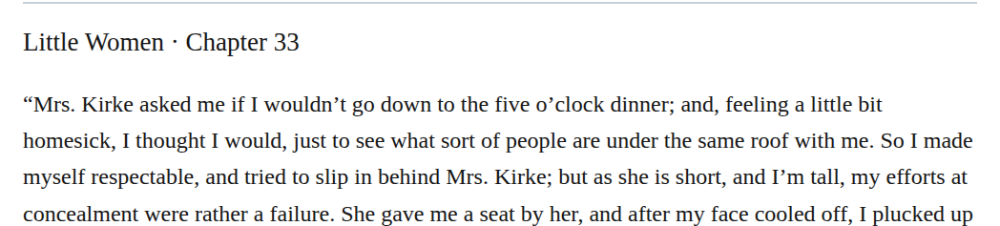

# Attributive time hyphen

Change “five o’clock dinner” to “five-o’clock dinner” in chapter 33. The spelled-out time directly modifies “dinner”; the retained typography rule requires hyphens in this position. High-confidence editorial correction; no printed-reading claim is needed.

| Location | Current → proposed | Exact patch |
| --- | --- | --- |
| [chapter 33, line 44](https://github.com/standardebooks/louisa-may-alcott_little-women/blob/38695106591f6060142dd1ad4da1d2aeded8ab8f/src/epub/text/chapter-33.xhtml#L44) | <code>five o’clock</code> → <code>five-o’clock</code> | [Patch](../../changes/five-oclock-dinner/baseline.patch) |

[Complete changes and proposed messages](appendix.md).

[Standard Ebooks digital text — Ebook context render — chapter 33 — full context render](../../assets/image-0097.png).
