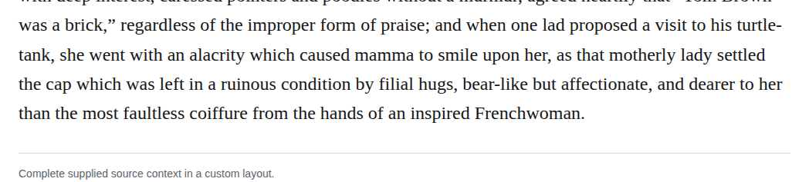

# Compound bearlike

Optionally change “bear-like” to “bearlike” in chapter 29. The retained basic Merriam-Webster adjective matches the description of affectionate filial hugs, supporting the production guide’s closed-compound permission. High confidence in this editorial recommendation does not make the change mandatory; the current form is clear.

| Location | Current → proposed | Exact patch |
| --- | --- | --- |
| [chapter 29, line 65](https://github.com/standardebooks/louisa-may-alcott_little-women/blob/38695106591f6060142dd1ad4da1d2aeded8ab8f/src/epub/text/chapter-29.xhtml#L65) | <code>bear-like</code> → <code>bearlike</code> | [Patch](../../changes/chapter29-bearlike/baseline.patch) |

[Complete changes and proposed messages](appendix.md).

[Standard Ebooks digital text — Ebook context render — chapter 29 — full context render](../../assets/image-0051.png).
