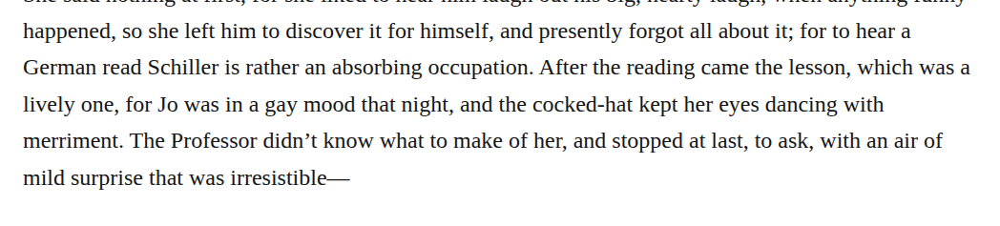
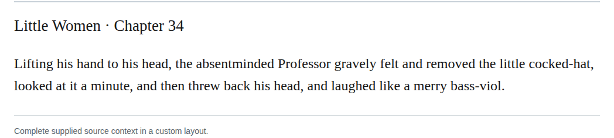

# Compound cocked hat

Change both “cocked-hat” nouns in chapter 34 to “cocked hat,” matching the other references to the paper cap. Step 17 recommends consistent compound spelling; the existing open forms and retained dictionary observation support the chosen direction. This is a high-confidence editorial recommendation, not a transcription restoration.

| Location | Current → proposed | Exact patch |
| --- | --- | --- |
| [chapter 34, line 63](https://github.com/standardebooks/louisa-may-alcott_little-women/blob/38695106591f6060142dd1ad4da1d2aeded8ab8f/src/epub/text/chapter-34.xhtml#L63) | <code>cocked-hat</code> → <code>cocked hat</code> | [Patch](../../changes/cocked-hat-consistency.change-01/baseline.patch) |
| [chapter 34, line 66](https://github.com/standardebooks/louisa-may-alcott_little-women/blob/38695106591f6060142dd1ad4da1d2aeded8ab8f/src/epub/text/chapter-34.xhtml#L66) | <code>cocked-hat,</code> → <code>cocked hat,</code> | [Patch](../../changes/cocked-hat-consistency.change-02/baseline.patch) |

[Complete changes and proposed messages](appendix.md).

[Standard Ebooks digital text — Ebook context render — chapter 34 — full context render](../../assets/image-0063.png).

[Standard Ebooks digital text — Ebook context render — chapter 34 — full context render](../../assets/image-0065.png).
