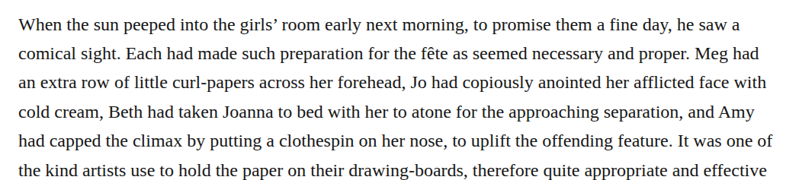

# Compound curlpapers

Optionally change “curl-papers” to “curlpapers” in chapter 12. The retained dictionary sense of curlpaper matches the hair-preparation objects on Meg’s forehead. Medium-confidence editorial modernization; the current hyphenated form remains intelligible, and no historical intention is asserted.

| Location | Current → proposed | Exact patch |
| --- | --- | --- |
| [chapter 12, line 53](https://github.com/standardebooks/louisa-may-alcott_little-women/blob/38695106591f6060142dd1ad4da1d2aeded8ab8f/src/epub/text/chapter-12.xhtml#L53) | <code>curl-papers</code> → <code>curlpapers</code> | [Patch](../../changes/hyphen-curlpapers/baseline.patch) |

[Complete changes and proposed messages](appendix.md).

[Standard Ebooks digital text — Ebook context render — chapter 12 — full context render](../../assets/image-0205.png).
