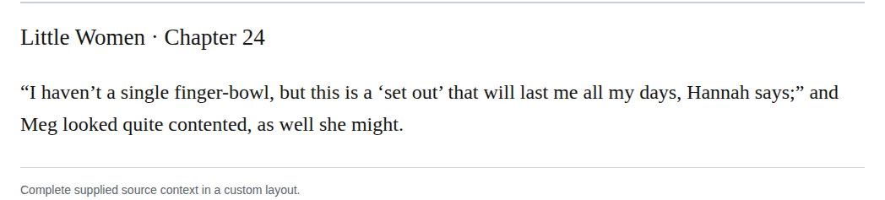

# Compound finger bowl

Change Meg’s “finger-bowl” to “finger bowl” in chapter 24, matching “finger bowls” immediately before it. Both name the same table vessel. Step 17 recommends consistent spelling, and the retained dictionary observation supports the open form. High-confidence editorial recommendation, not a source restoration.

| Location | Current → proposed | Exact patch |
| --- | --- | --- |
| [chapter 24, line 45](https://github.com/standardebooks/louisa-may-alcott_little-women/blob/38695106591f6060142dd1ad4da1d2aeded8ab8f/src/epub/text/chapter-24.xhtml#L45) | <code>finger-bowl,</code> → <code>finger bowl,</code> | [Patch](../../changes/chapter24-finger-bowl/baseline.patch) |

[Complete changes and proposed messages](appendix.md).

[Standard Ebooks digital text — Ebook context render — chapter 24 — full context render](../../assets/image-0033.png).
