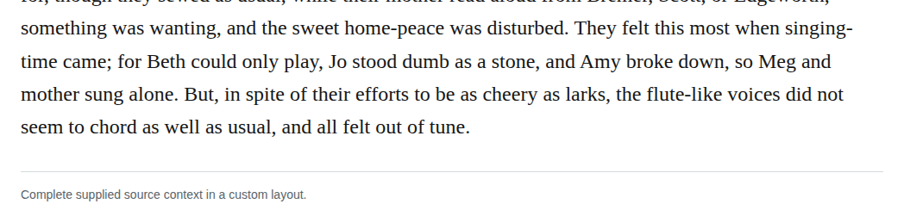

# Compound flutelike

Optionally change “flute-like” to “flutelike” in chapter 8. The retained adjective’s tonal sense fits Meg’s and her mother’s voices, even though their singing does not harmonize. Medium-confidence editorial preference; the current hyphenated spelling is equally clear.

| Location | Current → proposed | Exact patch |
| --- | --- | --- |
| [chapter 8, line 53](https://github.com/standardebooks/louisa-may-alcott_little-women/blob/38695106591f6060142dd1ad4da1d2aeded8ab8f/src/epub/text/chapter-8.xhtml#L53) | <code>flute-like</code> → <code>flutelike</code> | [Patch](../../changes/flutelike8/baseline.patch) |

[Complete changes and proposed messages](appendix.md).

[Standard Ebooks digital text — Ebook context render — chapter 8 — full context render](../../assets/image-0099.png).
