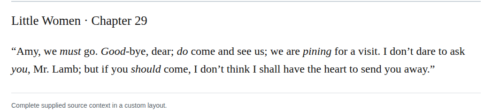

# Compound goodbye

Optionally change “&lt;em&gt;Good&lt;/em&gt;-bye” to “&lt;em&gt;Good&lt;/em&gt;bye” in chapter 29, retaining emphasis on “Good” alone. The retained basic dictionary report supports the closed farewell under the production guide’s optional closure permission. High-confidence recommendation; the hyphenated variant is not an error.

| Location | Current → proposed | Exact patch |
| --- | --- | --- |
| [chapter 29, line 55](https://github.com/standardebooks/louisa-may-alcott_little-women/blob/38695106591f6060142dd1ad4da1d2aeded8ab8f/src/epub/text/chapter-29.xhtml#L55) | <code>&lt;em&gt;Good&lt;/em&gt;-bye,</code> → <code>&lt;em&gt;Good&lt;/em&gt;bye,</code> | [Patch](../../changes/chapter29-goodbye/baseline.patch) |

[Complete changes and proposed messages](appendix.md).

[Standard Ebooks digital text — Ebook context render — chapter 29 — full context render](../../assets/image-0053.png).
