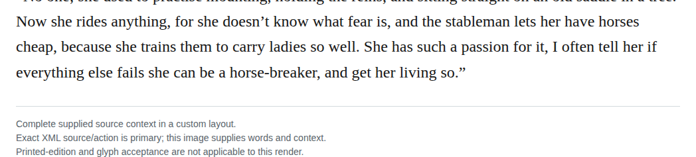

# Compound horsebreaker

Optionally change “horse-breaker” to “horsebreaker” in chapter 29. The surrounding speech describes training horses for riders, matching the retained dictionary noun. Its basic-search tier is unverified, so the recommendation rests on local meaning and the owner’s modernization preference. Medium confidence; the current spelling remains defensible.

| Location | Current → proposed | Exact patch |
| --- | --- | --- |
| [chapter 29, line 41](https://github.com/standardebooks/louisa-may-alcott_little-women/blob/38695106591f6060142dd1ad4da1d2aeded8ab8f/src/epub/text/chapter-29.xhtml#L41) | <code>horse-breaker,</code> → <code>horsebreaker,</code> | [Patch](../../changes/chapter29-horsebreaker/baseline.patch) |

[Complete changes and proposed messages](appendix.md).

[Standard Ebooks digital text — Ebook context render — chapter 29 — full context render](../../assets/image-0055.png).
