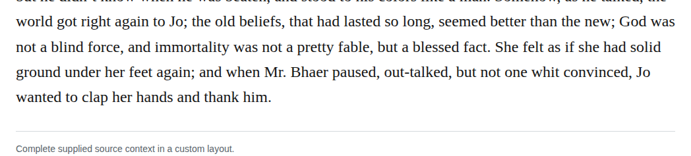

# Compound outtalked

Optionally change “out-talked” to “outtalked” in chapter 34. The retained basic dictionary entry supplies the inflected form, and the context distinguishes being surpassed in talking from being convinced. High-confidence recommendation under the optional closure permission; no transcription defect is alleged.

| Location | Current → proposed | Exact patch |
| --- | --- | --- |
| [chapter 34, line 59](https://github.com/standardebooks/louisa-may-alcott_little-women/blob/38695106591f6060142dd1ad4da1d2aeded8ab8f/src/epub/text/chapter-34.xhtml#L59) | <code>out-talked,</code> → <code>outtalked,</code> | [Patch](../../changes/outtalked/baseline.patch) |

[Complete changes and proposed messages](appendix.md).

[Standard Ebooks digital text — Ebook context render — chapter 34 — full context render](../../assets/image-0230.png).
