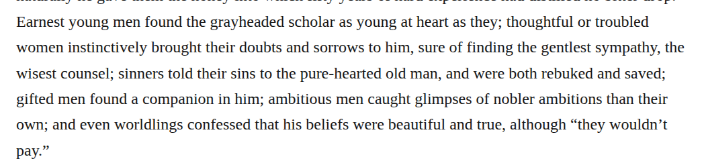

# Compound purehearted

Change “pure-hearted” to “purehearted” in chapter 24’s description of Mr. March. The retained dictionary report supports the closed adjective in this moral-character sense. This is an optional Editorial modernization under the owner’s better-reading preference, at medium confidence: the current spelling remains intelligible, and the specific basic-search condition in the compound guidance has not been established.

| Location | Current → proposed | Exact patch |
| --- | --- | --- |
| [chapter 24, line 16](https://github.com/standardebooks/louisa-may-alcott_little-women/blob/38695106591f6060142dd1ad4da1d2aeded8ab8f/src/epub/text/chapter-24.xhtml#L16) | <code>pure-hearted</code> → <code>purehearted</code> | [Patch](../../changes/chapter24-purehearted/baseline.patch) |

[Complete changes and proposed messages](appendix.md).

[Standard Ebooks digital text — Ebook context render — chapter 24 — full context render](../../assets/image-0037.png).
