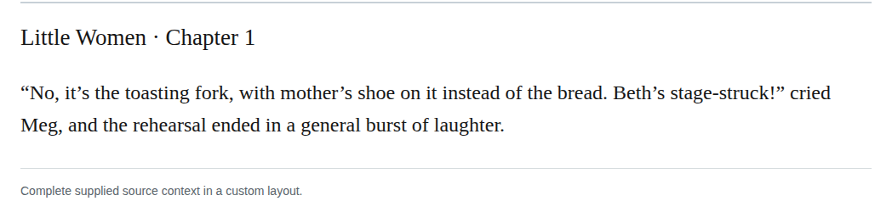

# Compound stagestruck

In chapter 1, change Beth’s “stage-struck” to “stagestruck.” Her absorption in the rehearsal fits the broad theatrical-fascination sense in the retained dictionary report; it need not mean that she wants an acting career. Recommend this as a medium-confidence, optional Editorial modernization, without calling the existing spelling erroneous.

| Location | Current → proposed | Exact patch |
| --- | --- | --- |
| [chapter 1, line 75](https://github.com/standardebooks/louisa-may-alcott_little-women/blob/38695106591f6060142dd1ad4da1d2aeded8ab8f/src/epub/text/chapter-1.xhtml#L75) | <code>stage-struck!”</code> → <code>stagestruck!”</code> | [Patch](../../changes/hyphen-stage-struck/baseline.patch) |

[Complete changes and proposed messages](appendix.md).

[Standard Ebooks digital text — Ebook context render — chapter 1 — full context render](../../assets/image-0213.png).
