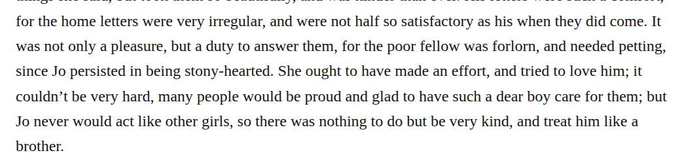

# Compound stonyhearted

Change “stony-hearted” to “stonyhearted” in chapter 41’s account of Amy’s view of Jo. The retained dictionary observation supports the closed adjective in this sense. This medium-confidence Editorial preference preserves the characterization; preservation is also reasonable because the compound guidance normally retains spacing and its specific basic-search exception is not fully demonstrated here.

| Location | Current → proposed | Exact patch |
| --- | --- | --- |
| [chapter 41, line 31](https://github.com/standardebooks/louisa-may-alcott_little-women/blob/38695106591f6060142dd1ad4da1d2aeded8ab8f/src/epub/text/chapter-41.xhtml#L31) | <code>stony-hearted.</code> → <code>stonyhearted.</code> | [Patch](../../changes/stonyhearted41/baseline.patch) |

[Complete changes and proposed messages](appendix.md).

[Standard Ebooks digital text — Ebook context render — chapter 41 — full context render](../../assets/image-0280.png).
