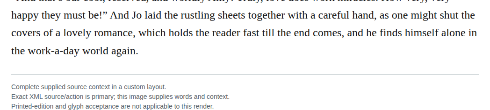
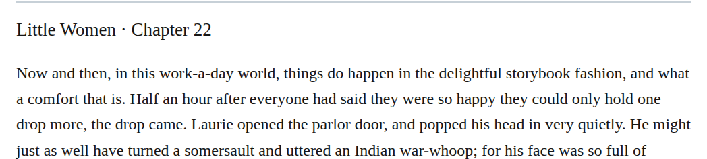

# Compound workaday

Change “work-a-day world” to “workaday world” in chapters 22 and 42. Both passages contrast ordinary life with romance or storybook events, fitting the same retained dictionary sense. Apply the closed form to both recorded siblings as a medium-confidence, optional Editorial modernization under the qualified basic-dictionary permission.

| Location | Current → proposed | Exact patch |
| --- | --- | --- |
| [chapter 42, line 53](https://github.com/standardebooks/louisa-may-alcott_little-women/blob/38695106591f6060142dd1ad4da1d2aeded8ab8f/src/epub/text/chapter-42.xhtml#L53) | <code>work-a-day</code> → <code>workaday</code> | [Patch](../../changes/workaday42/baseline.patch) |
| [chapter 22, line 73](https://github.com/standardebooks/louisa-may-alcott_little-women/blob/38695106591f6060142dd1ad4da1d2aeded8ab8f/src/epub/text/chapter-22.xhtml#L73) | <code>work-a-day</code> → <code>workaday</code> | [Patch](../../changes/workaday22/baseline.patch) |

[Complete changes and proposed messages](appendix.md).

[Standard Ebooks digital text — Ebook context render — chapter 42 — full context render](../../assets/image-0336.png).

[Standard Ebooks digital text — Ebook context render — chapter 22 — full context render](../../assets/image-0334.png).
