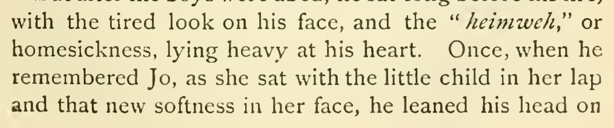
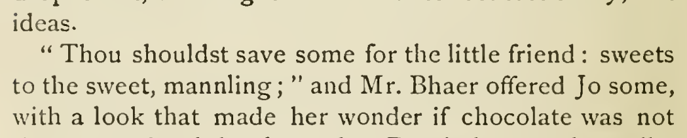
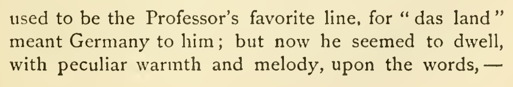
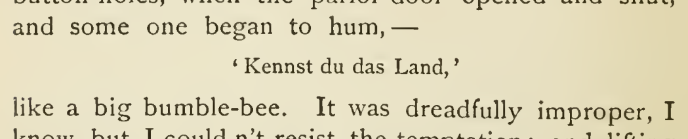

# German noun capitalization: detailed changes

## bubchen

Source: [chapter 45, line 53](https://github.com/standardebooks/louisa-may-alcott_little-women/blob/38695106591f6060142dd1ad4da1d2aeded8ab8f/src/epub/text/chapter-45.xhtml#L53).

Confidence: high.

Occurrences: 1.

<code>&lt;i xml:lang="de"&gt;bübchen&lt;/i&gt;?”</code> → <code>&lt;i xml:lang="de"&gt;Bübchen&lt;/i&gt;?”</code>.

[Exact patch](../../changes/bubchen/baseline.patch).

Proposed commit:

```text
[Editorial] Capitalize “Bübchen” (chapter 45, line 53)
```

## engel-kinder

Source: [chapter 2, line 49](https://github.com/standardebooks/louisa-may-alcott_little-women/blob/38695106591f6060142dd1ad4da1d2aeded8ab8f/src/epub/text/chapter-2.xhtml#L49).

Confidence: high.

Occurrences: 1.

<code>Engel-kinder!&lt;/i&gt;”</code> → <code>Engel-Kinder!&lt;/i&gt;”</code>.

[Exact patch](../../changes/engel-kinder/baseline.patch).

Proposed commit:

```text
[Editorial] Adjust capitalization of “Engel-Kinder” (chapter 2, line 49)
```

## heimweh

Source: [chapter 34, line 101](https://github.com/standardebooks/louisa-may-alcott_little-women/blob/38695106591f6060142dd1ad4da1d2aeded8ab8f/src/epub/text/chapter-34.xhtml#L101).

Confidence: medium.

Occurrences: 1.

<code>&lt;i xml:lang="de"&gt;heimweh&lt;/i&gt;,</code> → <code>&lt;i xml:lang="de"&gt;Heimweh&lt;/i&gt;,</code>.

[Exact patch](../../changes/heimweh/baseline.patch).

Proposed commit:

```text
[Editorial] Capitalize “Heimweh” (chapter 34, line 101)
```

## mannling

Source: [chapter 45, line 61](https://github.com/standardebooks/louisa-may-alcott_little-women/blob/38695106591f6060142dd1ad4da1d2aeded8ab8f/src/epub/text/chapter-45.xhtml#L61).

Confidence: medium.

Occurrences: 1.

<code>&lt;i xml:lang="de"&gt;mannling&lt;/i&gt;;”</code> → <code>&lt;i xml:lang="de"&gt;Mannling&lt;/i&gt;;”</code>.

[Exact patch](../../changes/mannling/baseline.patch).

Proposed commit:

```text
[Editorial] Capitalize “Mannling” (chapter 45, line 61)
```

## das-land-chapter43

Source: [chapter 43, line 147](https://github.com/standardebooks/louisa-may-alcott_little-women/blob/38695106591f6060142dd1ad4da1d2aeded8ab8f/src/epub/text/chapter-43.xhtml#L147).

Confidence: high.

Occurrences: 1.

<code>land&lt;/i&gt;”</code> → <code>Land&lt;/i&gt;”</code>.

[Exact patch](../../changes/das-land-chapter43/baseline.patch).

Proposed commit:

```text
[Editorial] Capitalize “Land” (chapter 43, line 147)
```

## v4-group-77

Source: [chapter 33, line 33](https://github.com/standardebooks/louisa-may-alcott_little-women/blob/38695106591f6060142dd1ad4da1d2aeded8ab8f/src/epub/text/chapter-33.xhtml#L33).

Confidence: medium.

Occurrences: 1.

<code>land&lt;/i&gt;,’&lt;/p&gt;</code> → <code>Land&lt;/i&gt;,’&lt;/p&gt;</code>.

[Exact patch](../../changes/v4-group-77/baseline.patch).

Proposed commit:

```text
[Editorial] Capitalize “Land” (chapter 33, line 33)
```



[1915 Little, Brown (Smith illustrations) — 1915 Little, Brown (Smith illustrations), physical page 473 — full page](../../assets/image-0201.png).



[1915 Little, Brown (Smith illustrations) — 1915 Little, Brown (Smith illustrations), physical page 612 — full page](../../assets/image-0016.png).



[1915 Little, Brown (Smith illustrations) — 1915 Little, Brown (Smith illustrations), physical page 597 — full page](../../assets/image-0083.png).



[1915 Little, Brown (Smith illustrations) — 1915 Little, Brown (Smith illustrations) — full page](../../assets/image-0328.png).
