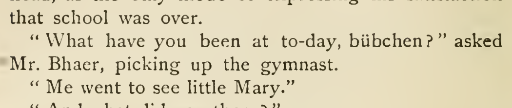
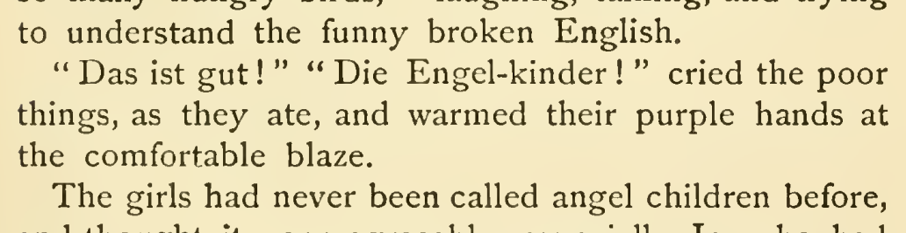

# German noun capitalization

Capitalize the German nouns at these six selected sites: Bübchen and Mannling in chapter 45, Kinder in “Die Engel-Kinder” in chapter 2, Heimweh in chapter 34, and Land in chapters 33 and 43. The local addresses, article das and explanatory glosses support nominal German use. These are discretionary Editorial orthographic choices under the owner’s better-reading preference. Preserve the lexical spelling of Mannling and the compound hyphen; Heimweh’s possible English borrowing and the contrary earlier lowercase lyric reading limit those cases to medium confidence. Confidence is medium for Heimweh, Mannling and Land in chapter 33, and high for the other three sites.

Confidence: 3 high; 3 medium.

| Location | Current → proposed | Exact patch |
| --- | --- | --- |
| [chapter 45, line 53](https://github.com/standardebooks/louisa-may-alcott_little-women/blob/38695106591f6060142dd1ad4da1d2aeded8ab8f/src/epub/text/chapter-45.xhtml#L53) | <code>&lt;i xml:lang="de"&gt;bübchen&lt;/i&gt;?”</code> → <code>&lt;i xml:lang="de"&gt;Bübchen&lt;/i&gt;?”</code> | [Patch](../../changes/bubchen/baseline.patch) |
| [chapter 2, line 49](https://github.com/standardebooks/louisa-may-alcott_little-women/blob/38695106591f6060142dd1ad4da1d2aeded8ab8f/src/epub/text/chapter-2.xhtml#L49) | <code>Engel-kinder!&lt;/i&gt;”</code> → <code>Engel-Kinder!&lt;/i&gt;”</code> | [Patch](../../changes/engel-kinder/baseline.patch) |
| [chapter 34, line 101](https://github.com/standardebooks/louisa-may-alcott_little-women/blob/38695106591f6060142dd1ad4da1d2aeded8ab8f/src/epub/text/chapter-34.xhtml#L101) | <code>&lt;i xml:lang="de"&gt;heimweh&lt;/i&gt;,</code> → <code>&lt;i xml:lang="de"&gt;Heimweh&lt;/i&gt;,</code> | [Patch](../../changes/heimweh/baseline.patch) |
| [chapter 45, line 61](https://github.com/standardebooks/louisa-may-alcott_little-women/blob/38695106591f6060142dd1ad4da1d2aeded8ab8f/src/epub/text/chapter-45.xhtml#L61) | <code>&lt;i xml:lang="de"&gt;mannling&lt;/i&gt;;”</code> → <code>&lt;i xml:lang="de"&gt;Mannling&lt;/i&gt;;”</code> | [Patch](../../changes/mannling/baseline.patch) |
| [chapter 43, line 147](https://github.com/standardebooks/louisa-may-alcott_little-women/blob/38695106591f6060142dd1ad4da1d2aeded8ab8f/src/epub/text/chapter-43.xhtml#L147) | <code>land&lt;/i&gt;”</code> → <code>Land&lt;/i&gt;”</code> | [Patch](../../changes/das-land-chapter43/baseline.patch) |
| [chapter 33, line 33](https://github.com/standardebooks/louisa-may-alcott_little-women/blob/38695106591f6060142dd1ad4da1d2aeded8ab8f/src/epub/text/chapter-33.xhtml#L33) | <code>land&lt;/i&gt;,’&lt;/p&gt;</code> → <code>Land&lt;/i&gt;,’&lt;/p&gt;</code> | [Patch](../../changes/v4-group-77/baseline.patch) |

[Complete changes and proposed messages](appendix.md).

[1915 Little, Brown (Smith illustrations) — 1915 Little, Brown (Smith illustrations), physical page 612 — full page](../../assets/image-0016.png).

[1915 Little, Brown (Smith illustrations) — 1915 Little, Brown (Smith illustrations), physical page 33 — full page](../../assets/image-0093.png).
