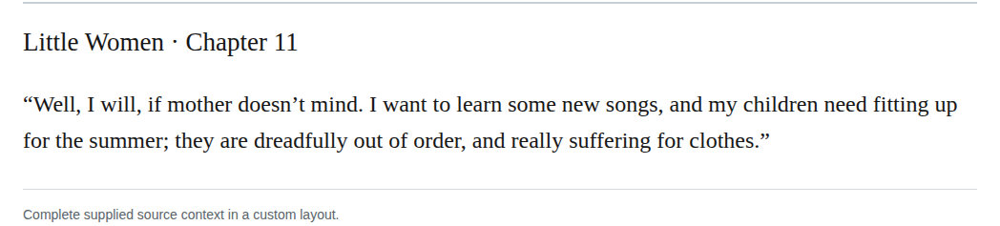
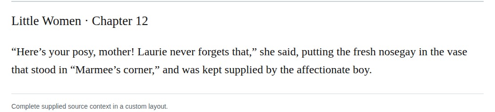

# Capitalize kinship terms used as personal names

Capitalize Father and Mother at 238 places where the contextual review identifies personal-name use; preserve the other 314 occurrences in the 552-occurrence Mother/Father inventory. These remain discretionary editorial modernizations under the scoped kinship policy: SEMoS8.3.1 supplies general modern-style guidance, while the retained CMoS18§8.37 paraphrase is supplementary and does not establish mandatory force.

Confidence: 234 high; 4 medium.

This group contains 238 changes. The 12 representative examples below are spaced across the change list; the appendix retains every change and proposed commit message.

| Location | Current → proposed | Exact patch |
| --- | --- | --- |
| [chapter-1.xhtml:17:18](https://github.com/chmod007/little-women-audit-publication-sandbox-canonical-20261030/blob/38695106591f6060142dd1ad4da1d2aeded8ab8f/src/epub/text/chapter-1.xhtml#L17) | <code>father</code> → <code>Father</code> | [Patch](../../changes/parent-name-chapter-1-1054/baseline.patch) |
| [chapter-11.xhtml:99:15](https://github.com/chmod007/little-women-audit-publication-sandbox-canonical-20261030/blob/38695106591f6060142dd1ad4da1d2aeded8ab8f/src/epub/text/chapter-11.xhtml#L99) | <code>mother,</code> → <code>Mother,</code> | [Patch](../../changes/parent-name-chapter-11-24237/baseline.patch) |
| [chapter-16.xhtml:28:114](https://github.com/chmod007/little-women-audit-publication-sandbox-canonical-20261030/blob/38695106591f6060142dd1ad4da1d2aeded8ab8f/src/epub/text/chapter-16.xhtml#L28) | <code>mother’s</code> → <code>Mother’s</code> | [Patch](../../changes/parent-name-chapter-16-5373/baseline.patch) |
| [chapter-17.xhtml:75:256](https://github.com/chmod007/little-women-audit-publication-sandbox-canonical-20261030/blob/38695106591f6060142dd1ad4da1d2aeded8ab8f/src/epub/text/chapter-17.xhtml#L75) | <code>mother</code> → <code>Mother</code> | [Patch](../../changes/parent-name-chapter-17-13224/baseline.patch) |
| [chapter-20.xhtml:30:38](https://github.com/chmod007/little-women-audit-publication-sandbox-canonical-20261030/blob/38695106591f6060142dd1ad4da1d2aeded8ab8f/src/epub/text/chapter-20.xhtml#L30) | <code>mother.”&lt;/p&gt;</code> → <code>Mother.”&lt;/p&gt;</code> | [Patch](../../changes/parent-name-chapter-20-8052/baseline.patch) |
| [chapter-23.xhtml:56:13](https://github.com/chmod007/little-women-audit-publication-sandbox-canonical-20261030/blob/38695106591f6060142dd1ad4da1d2aeded8ab8f/src/epub/text/chapter-23.xhtml#L56) | <code>father’s</code> → <code>Father’s</code> | [Patch](../../changes/parent-name-chapter-23-11476/baseline.patch) |
| [chapter-28.xhtml:46:250](https://github.com/chmod007/little-women-audit-publication-sandbox-canonical-20261030/blob/38695106591f6060142dd1ad4da1d2aeded8ab8f/src/epub/text/chapter-28.xhtml#L46) | <code>mother’s,</code> → <code>Mother’s,</code> | [Patch](../../changes/parent-name-chapter-28-12301/baseline.patch) |
| [chapter-33.xhtml:17:161](https://github.com/chmod007/little-women-audit-publication-sandbox-canonical-20261030/blob/38695106591f6060142dd1ad4da1d2aeded8ab8f/src/epub/text/chapter-33.xhtml#L17) | <code>father’s</code> → <code>Father’s</code> | [Patch](../../changes/parent-name-chapter-33-1029/baseline.patch) |
| [chapter-38.xhtml:42:241](https://github.com/chmod007/little-women-audit-publication-sandbox-canonical-20261030/blob/38695106591f6060142dd1ad4da1d2aeded8ab8f/src/epub/text/chapter-38.xhtml#L42) | <code>father</code> → <code>Father</code> | [Patch](../../changes/parent-name-chapter-38-10084/baseline.patch) |
| [chapter-42.xhtml:40:21](https://github.com/chmod007/little-women-audit-publication-sandbox-canonical-20261030/blob/38695106591f6060142dd1ad4da1d2aeded8ab8f/src/epub/text/chapter-42.xhtml#L40) | <code>mother?”</code> → <code>Mother?”</code> | [Patch](../../changes/parent-name-chapter-42-12444/baseline.patch) |
| [chapter-8.xhtml:53:641](https://github.com/chmod007/little-women-audit-publication-sandbox-canonical-20261030/blob/38695106591f6060142dd1ad4da1d2aeded8ab8f/src/epub/text/chapter-8.xhtml#L53) | <code>mother</code> → <code>Mother</code> | [Patch](../../changes/parent-name-chapter-8-10383/baseline.patch) |
| [chapter-9.xhtml:162:611](https://github.com/chmod007/little-women-audit-publication-sandbox-canonical-20261030/blob/38695106591f6060142dd1ad4da1d2aeded8ab8f/src/epub/text/chapter-9.xhtml#L162) | <code>father</code> → <code>Father</code> | [Patch](../../changes/parent-name-chapter-9-38420/baseline.patch) |

[Complete changes and proposed messages](appendix.md).

[Standard Ebooks digital text — Ebook context render — chapter 11 — full context render](../../assets/image-0232.png).

[Standard Ebooks digital text — Ebook context render — chapter 12 — full context render](../../assets/image-0234.png).
