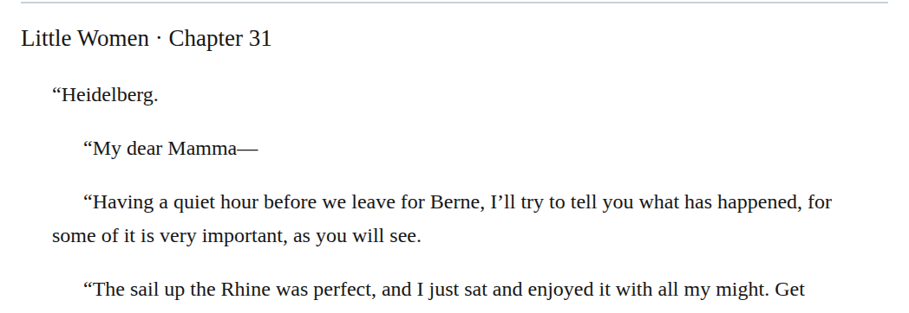
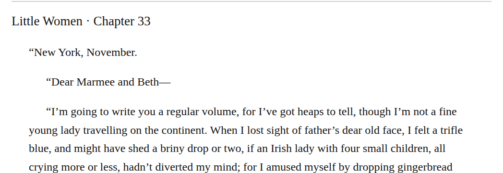
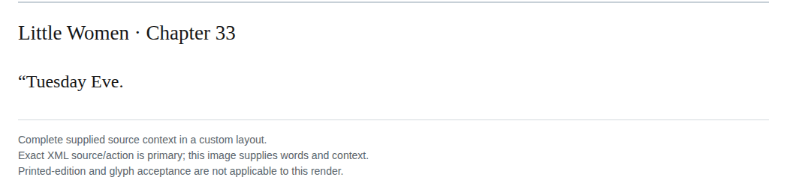
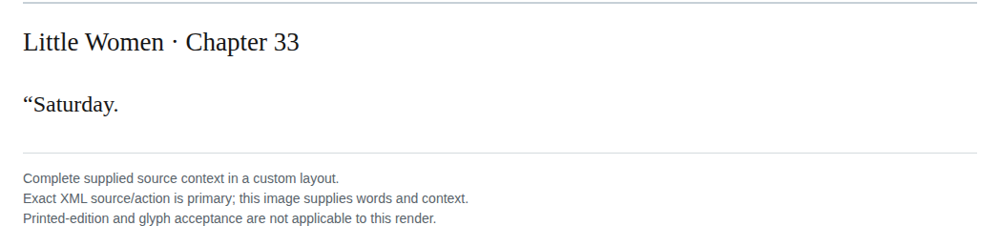
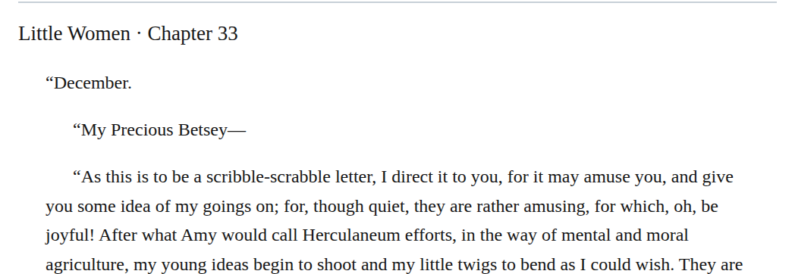
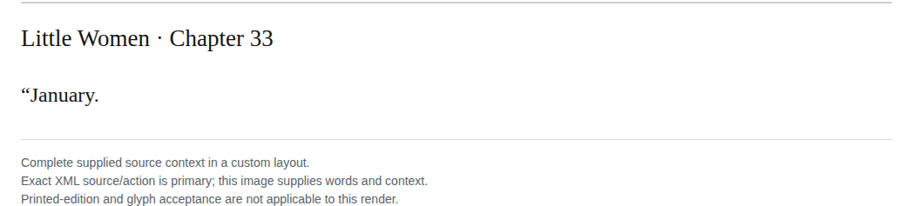

# Letter prebody containment: detailed changes

## git-09-current-proposal-015

Source: [chapter 31, line 15](https://github.com/standardebooks/louisa-may-alcott_little-women/blob/38695106591f6060142dd1ad4da1d2aeded8ab8f/src/epub/text/chapter-31.xhtml#L15).

Occurrences: 1.

<code>&lt;p epub:type="se:letter.dateline"&gt;“London.&lt;/p&gt;&#10;				&lt;p epub:type="z3998:salutation"&gt;“Dearest People⁠—&lt;/p&gt;</code> → <code>&lt;header role="presentation"&gt;&#10;					&lt;p epub:type="se:letter.dateline"&gt;“London.&lt;/p&gt;&#10;					&lt;p epub:type="z3998:salutation"&gt;“Dearest People⁠—&lt;/p&gt;&#10;				&lt;/header&gt;</code>.

[Exact patch](../../changes/git-09-current-proposal-015/baseline.patch).

Proposed commit:

```text
Update ““London. “Dearest People⁠—” markup (chapter 31, line 15)
```

## git-09-current-proposal-018

Source: [chapter 31, line 53](https://github.com/standardebooks/louisa-may-alcott_little-women/blob/38695106591f6060142dd1ad4da1d2aeded8ab8f/src/epub/text/chapter-31.xhtml#L53).

Occurrences: 1.

<code>&lt;p epub:type="se:letter.dateline"&gt;“Paris.&lt;/p&gt;&#10;				&lt;p epub:type="z3998:salutation"&gt;“Dear Girls⁠—&lt;/p&gt;</code> → <code>&lt;header role="presentation"&gt;&#10;					&lt;p epub:type="se:letter.dateline"&gt;“Paris.&lt;/p&gt;&#10;					&lt;p epub:type="z3998:salutation"&gt;“Dear Girls⁠—&lt;/p&gt;&#10;				&lt;/header&gt;</code>.

[Exact patch](../../changes/git-09-current-proposal-018/baseline.patch).

Proposed commit:

```text
Update ““Paris. “Dear Girls⁠—” markup (chapter 31, line 53)
```

## git-09-current-proposal-022

Source: [chapter 31, line 67](https://github.com/standardebooks/louisa-may-alcott_little-women/blob/38695106591f6060142dd1ad4da1d2aeded8ab8f/src/epub/text/chapter-31.xhtml#L67).

Occurrences: 1.

<code>&lt;p epub:type="se:letter.dateline"&gt;“Heidelberg.&lt;/p&gt;&#10;				&lt;p epub:type="z3998:salutation"&gt;“My dear Mamma⁠—&lt;/p&gt;</code> → <code>&lt;header role="presentation"&gt;&#10;					&lt;p epub:type="se:letter.dateline"&gt;“Heidelberg.&lt;/p&gt;&#10;					&lt;p epub:type="z3998:salutation"&gt;“My dear Mamma⁠—&lt;/p&gt;&#10;				&lt;/header&gt;</code>.

[Exact patch](../../changes/git-09-current-proposal-022/baseline.patch).

Proposed commit:

```text
Update ““Heidelberg. “My dear Mamma⁠—” markup (chapter 31, line 67)
```

## git-09-current-proposal-025

Source: [chapter 33, line 15](https://github.com/standardebooks/louisa-may-alcott_little-women/blob/38695106591f6060142dd1ad4da1d2aeded8ab8f/src/epub/text/chapter-33.xhtml#L15).

Occurrences: 1.

<code>&lt;p epub:type="se:letter.dateline"&gt;“New York, November.&lt;/p&gt;&#10;				&lt;p epub:type="z3998:salutation"&gt;“Dear Marmee and Beth⁠—&lt;/p&gt;</code> → <code>&lt;header role="presentation"&gt;&#10;					&lt;p epub:type="se:letter.dateline"&gt;“New York, November.&lt;/p&gt;&#10;					&lt;p epub:type="z3998:salutation"&gt;“Dear Marmee and Beth⁠—&lt;/p&gt;&#10;				&lt;/header&gt;</code>.

[Exact patch](../../changes/git-09-current-proposal-025/baseline.patch).

Proposed commit:

```text
Update ““New York, November. “Dear Marmee and Beth⁠—” markup (chapter 33, line 15)
```

## git-09-current-proposal-026

Source: [chapter 33, line 30](https://github.com/standardebooks/louisa-may-alcott_little-women/blob/38695106591f6060142dd1ad4da1d2aeded8ab8f/src/epub/text/chapter-33.xhtml#L30).

Occurrences: 1.

<code>&lt;p epub:type="se:letter.dateline"&gt;“Tuesday Eve.&lt;/p&gt;</code> → <code>&lt;header role="presentation"&gt;&#10;					&lt;p epub:type="se:letter.dateline"&gt;“Tuesday Eve.&lt;/p&gt;&#10;				&lt;/header&gt;</code>.

[Exact patch](../../changes/git-09-current-proposal-026/baseline.patch).

Proposed commit:

```text
Update ““Tuesday Eve.” markup (chapter 33, line 30)
```

## git-09-current-proposal-027

Source: [chapter 33, line 55](https://github.com/standardebooks/louisa-may-alcott_little-women/blob/38695106591f6060142dd1ad4da1d2aeded8ab8f/src/epub/text/chapter-33.xhtml#L55).

Occurrences: 1.

<code>&lt;p epub:type="se:letter.dateline"&gt;“Thursday.&lt;/p&gt;</code> → <code>&lt;header role="presentation"&gt;&#10;					&lt;p epub:type="se:letter.dateline"&gt;“Thursday.&lt;/p&gt;&#10;				&lt;/header&gt;</code>.

[Exact patch](../../changes/git-09-current-proposal-027/baseline.patch).

Proposed commit:

```text
Update ““Thursday.” markup (chapter 33, line 55)
```

## git-09-current-proposal-028

Source: [chapter 33, line 67](https://github.com/standardebooks/louisa-may-alcott_little-women/blob/38695106591f6060142dd1ad4da1d2aeded8ab8f/src/epub/text/chapter-33.xhtml#L67).

Occurrences: 1.

<code>&lt;p epub:type="se:letter.dateline"&gt;“Saturday.&lt;/p&gt;</code> → <code>&lt;header role="presentation"&gt;&#10;					&lt;p epub:type="se:letter.dateline"&gt;“Saturday.&lt;/p&gt;&#10;				&lt;/header&gt;</code>.

[Exact patch](../../changes/git-09-current-proposal-028/baseline.patch).

Proposed commit:

```text
Update ““Saturday.” markup (chapter 33, line 67)
```

## git-09-current-proposal-031

Source: [chapter 33, line 81](https://github.com/standardebooks/louisa-may-alcott_little-women/blob/38695106591f6060142dd1ad4da1d2aeded8ab8f/src/epub/text/chapter-33.xhtml#L81).

Occurrences: 1.

<code>&lt;p epub:type="se:letter.dateline"&gt;“December.&lt;/p&gt;&#10;				&lt;p epub:type="z3998:salutation"&gt;“My Precious Betsey⁠—&lt;/p&gt;</code> → <code>&lt;header role="presentation"&gt;&#10;					&lt;p epub:type="se:letter.dateline"&gt;“December.&lt;/p&gt;&#10;					&lt;p epub:type="z3998:salutation"&gt;“My Precious Betsey⁠—&lt;/p&gt;&#10;				&lt;/header&gt;</code>.

[Exact patch](../../changes/git-09-current-proposal-031/baseline.patch).

Proposed commit:

```text
Update ““December. “My Precious Betsey⁠—” markup (chapter 33, line 81)
```

## git-09-current-proposal-032

Source: [chapter 33, line 100](https://github.com/standardebooks/louisa-may-alcott_little-women/blob/38695106591f6060142dd1ad4da1d2aeded8ab8f/src/epub/text/chapter-33.xhtml#L100).

Occurrences: 1.

<code>&lt;p epub:type="se:letter.dateline"&gt;“January.&lt;/p&gt;</code> → <code>&lt;header role="presentation"&gt;&#10;					&lt;p epub:type="se:letter.dateline"&gt;“January.&lt;/p&gt;&#10;				&lt;/header&gt;</code>.

[Exact patch](../../changes/git-09-current-proposal-032/baseline.patch).

Proposed commit:

```text
Update ““January.” markup (chapter 33, line 100)
```



[Standard Ebooks digital text — Ebook context render — chapter 31 — full context render](../../assets/image-0159.png).



[Standard Ebooks digital text — Ebook context render — chapter 33 — full context render](../../assets/image-0165.png).



[Standard Ebooks digital text — Ebook context render — chapter 33 — full context render](../../assets/image-0167.png).


[Standard Ebooks digital text — Ebook context render — chapter 33 — full context render](../../assets/image-0169.png).



[Standard Ebooks digital text — Ebook context render — chapter 33 — full context render](../../assets/image-0171.png).



[Standard Ebooks digital text — Ebook context render — chapter 33 — full context render](../../assets/image-0175.png).



[Standard Ebooks digital text — Ebook context render — chapter 33 — full context render](../../assets/image-0177.png).
