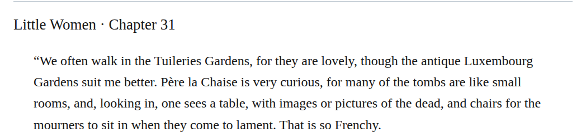
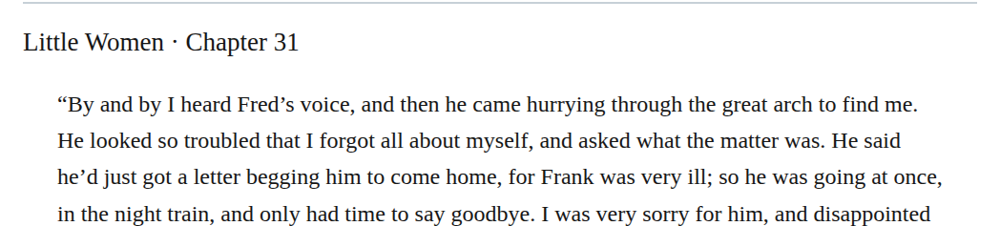

# Letter semantic inflection: detailed changes

## december-letter-semantics

Source: [chapter 33, line 80](https://github.com/standardebooks/louisa-may-alcott_little-women/blob/38695106591f6060142dd1ad4da1d2aeded8ab8f/src/epub/text/chapter-33.xhtml#L80).

Occurrences: 1.

<code>&lt;blockquote&gt;</code> → <code>&lt;blockquote epub:type="z3998:letter"&gt;</code>.

[Exact patch](../../changes/december-letter-semantics/baseline.patch).

Proposed commit:

```text
Letter semantic inflection (chapter 33, line 80)
```

## git-09-current-proposal-014

Source: [chapter 31, line 14](https://github.com/standardebooks/louisa-may-alcott_little-women/blob/38695106591f6060142dd1ad4da1d2aeded8ab8f/src/epub/text/chapter-31.xhtml#L14).

Occurrences: 1.

<code>&lt;blockquote&gt;</code> → <code>&lt;blockquote epub:type="z3998:letter"&gt;</code>.

[Exact patch](../../changes/git-09-current-proposal-014/baseline.patch).

Proposed commit:

```text
Letter semantic inflection (chapter 31, line 14)
```

## git-09-current-proposal-017

Source: [chapter 31, line 52](https://github.com/standardebooks/louisa-may-alcott_little-women/blob/38695106591f6060142dd1ad4da1d2aeded8ab8f/src/epub/text/chapter-31.xhtml#L52).

Occurrences: 1.

<code>&lt;blockquote&gt;</code> → <code>&lt;blockquote epub:type="z3998:letter"&gt;</code>.

[Exact patch](../../changes/git-09-current-proposal-017/baseline.patch).

Proposed commit:

```text
Letter semantic inflection (chapter 31, line 52)
```

## git-09-current-proposal-019

Source: [chapter 31, line 60](https://github.com/standardebooks/louisa-may-alcott_little-women/blob/38695106591f6060142dd1ad4da1d2aeded8ab8f/src/epub/text/chapter-31.xhtml#L60).

Occurrences: 1.

<code>&lt;blockquote&gt;</code> → <code>&lt;blockquote epub:type="z3998:letter"&gt;</code>.

[Exact patch](../../changes/git-09-current-proposal-019/baseline.patch).

Proposed commit:

```text
Letter semantic inflection (chapter 31, line 60)
```

## git-09-current-proposal-021

Source: [chapter 31, line 66](https://github.com/standardebooks/louisa-may-alcott_little-women/blob/38695106591f6060142dd1ad4da1d2aeded8ab8f/src/epub/text/chapter-31.xhtml#L66).

Occurrences: 1.

<code>&lt;blockquote&gt;</code> → <code>&lt;blockquote epub:type="z3998:letter"&gt;</code>.

[Exact patch](../../changes/git-09-current-proposal-021/baseline.patch).

Proposed commit:

```text
Letter semantic inflection (chapter 31, line 66)
```

## git-09-current-proposal-023

Source: [chapter 31, line 76](https://github.com/standardebooks/louisa-may-alcott_little-women/blob/38695106591f6060142dd1ad4da1d2aeded8ab8f/src/epub/text/chapter-31.xhtml#L76).

Occurrences: 1.

<code>&lt;blockquote&gt;</code> → <code>&lt;blockquote epub:type="z3998:letter"&gt;</code>.

[Exact patch](../../changes/git-09-current-proposal-023/baseline.patch).

Proposed commit:

```text
Letter semantic inflection (chapter 31, line 76)
```



[Standard Ebooks digital text — Ebook context render — chapter 31 — full context render](../../assets/image-0155.png).


[Standard Ebooks digital text — Ebook context render — chapter 31 — full context render](../../assets/image-0159.png).



[Standard Ebooks digital text — Ebook context render — chapter 31 — full context render](../../assets/image-0161.png).
