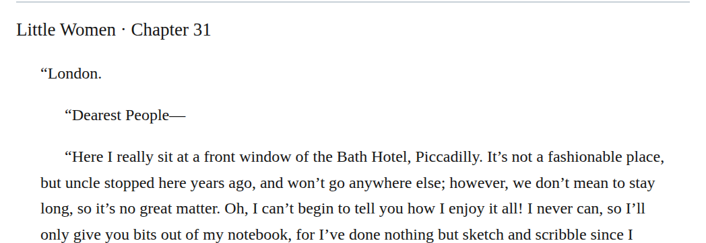
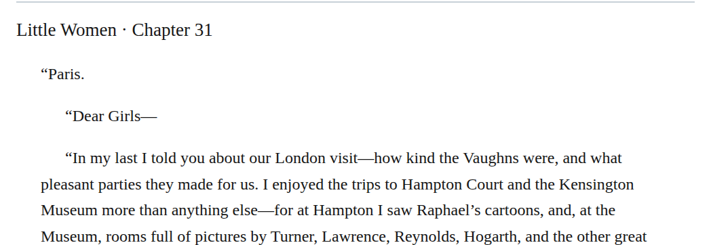

# Letter semantic inflection

Add z3998:letter to the six selected correspondence blockquotes in chapters 31 and 33. Their letter context establishes correspondence even where a fragment continues without a fresh salutation. The Manual requires letter inflection on these blockquotes. Existing content and boundaries remain intact.

| Location | Current → proposed | Exact patch |
| --- | --- | --- |
| [chapter 33, line 80](https://github.com/standardebooks/louisa-may-alcott_little-women/blob/38695106591f6060142dd1ad4da1d2aeded8ab8f/src/epub/text/chapter-33.xhtml#L80) | <code>&lt;blockquote&gt;</code> → <code>&lt;blockquote epub:type="z3998:letter"&gt;</code> | [Patch](../../changes/december-letter-semantics/baseline.patch) |
| [chapter 31, line 14](https://github.com/standardebooks/louisa-may-alcott_little-women/blob/38695106591f6060142dd1ad4da1d2aeded8ab8f/src/epub/text/chapter-31.xhtml#L14) | <code>&lt;blockquote&gt;</code> → <code>&lt;blockquote epub:type="z3998:letter"&gt;</code> | [Patch](../../changes/git-09-current-proposal-014/baseline.patch) |
| [chapter 31, line 52](https://github.com/standardebooks/louisa-may-alcott_little-women/blob/38695106591f6060142dd1ad4da1d2aeded8ab8f/src/epub/text/chapter-31.xhtml#L52) | <code>&lt;blockquote&gt;</code> → <code>&lt;blockquote epub:type="z3998:letter"&gt;</code> | [Patch](../../changes/git-09-current-proposal-017/baseline.patch) |
| [chapter 31, line 60](https://github.com/standardebooks/louisa-may-alcott_little-women/blob/38695106591f6060142dd1ad4da1d2aeded8ab8f/src/epub/text/chapter-31.xhtml#L60) | <code>&lt;blockquote&gt;</code> → <code>&lt;blockquote epub:type="z3998:letter"&gt;</code> | [Patch](../../changes/git-09-current-proposal-019/baseline.patch) |
| [chapter 31, line 66](https://github.com/standardebooks/louisa-may-alcott_little-women/blob/38695106591f6060142dd1ad4da1d2aeded8ab8f/src/epub/text/chapter-31.xhtml#L66) | <code>&lt;blockquote&gt;</code> → <code>&lt;blockquote epub:type="z3998:letter"&gt;</code> | [Patch](../../changes/git-09-current-proposal-021/baseline.patch) |
| [chapter 31, line 76](https://github.com/standardebooks/louisa-may-alcott_little-women/blob/38695106591f6060142dd1ad4da1d2aeded8ab8f/src/epub/text/chapter-31.xhtml#L76) | <code>&lt;blockquote&gt;</code> → <code>&lt;blockquote epub:type="z3998:letter"&gt;</code> | [Patch](../../changes/git-09-current-proposal-023/baseline.patch) |

[Complete changes and proposed messages](appendix.md).

[Standard Ebooks digital text — Ebook context render — chapter 31 — full context render](../../assets/image-0149.png).

[Standard Ebooks digital text — Ebook context render — chapter 31 — full context render](../../assets/image-0153.png).
