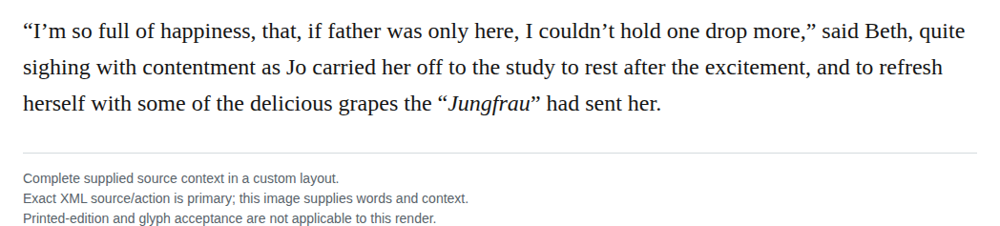

# Ordinary proper name language removal

Render the quoted Jungfrau appellation in plain roman without a language carrier. The sentence identifies the Jungfrau as the sender of grapes to Beth; this is a personal or personified appellation, not a geographical reference. The local naming function supports the owner’s proper-name language policy without identifying a particular bearer.

| Location | Current → proposed | Exact patch |
| --- | --- | --- |
| [chapter 22, line 68](https://github.com/standardebooks/louisa-may-alcott_little-women/blob/38695106591f6060142dd1ad4da1d2aeded8ab8f/src/epub/text/chapter-22.xhtml#L68) | <code>&lt;i xml:lang="de"&gt;Jungfrau&lt;/i&gt;” had sent her.&lt;/p&gt;&#10;			&lt;p&gt;“So am I,” added Jo, slapping the pocket wherein reposed the long-desired &lt;i epub:type="se:name.publication.book"&gt;Undine and Sintram&lt;/i&gt;</code> → <code>Jungfrau” had sent her.&lt;/p&gt;&#10;			&lt;p&gt;“So am I,” added Jo, slapping the pocket wherein reposed the long-desired &lt;i epub:type="se:name.publication.book"&gt;Undine and Sintram&lt;/i&gt;</code> | [Patch](../../changes/typed-carrier-parallel-occurrences-recovery-31/baseline.patch) |

[Complete changes and proposed messages](appendix.md).

[Standard Ebooks digital text — Ebook context render — chapter 22 — full context render](../../assets/image-0302.png).
