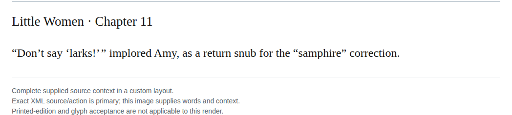

# Outer exclamation ownership

In chapter 11, change “Don’t say ‘larks!’ ” to “Don’t say ‘larks’!” so the exclamation belongs to Amy’s outer imperative, rather than the quoted word. Moving it separates the closing quotation marks, so their intervening hair space is removed. The inner-word emphasis remains a coherent alternative; this punctuation choice is discretionary, with medium confidence. The hair-space rule governs the resulting typography, not the decision about emphasis.

| Location | Current → proposed | Exact patch |
| --- | --- | --- |
| [chapter 11, line 22](https://github.com/standardebooks/louisa-may-alcott_little-women/blob/38695106591f6060142dd1ad4da1d2aeded8ab8f/src/epub/text/chapter-11.xhtml#L22) | <code>‘larks!’ </code> → <code>‘larks’!</code> | [Patch](../../changes/quotation195-a-103/baseline.patch) |

[Complete changes and proposed messages](appendix.md).

[Standard Ebooks digital text — Ebook context render — chapter 11 — full context render](../../assets/image-0264.png).
