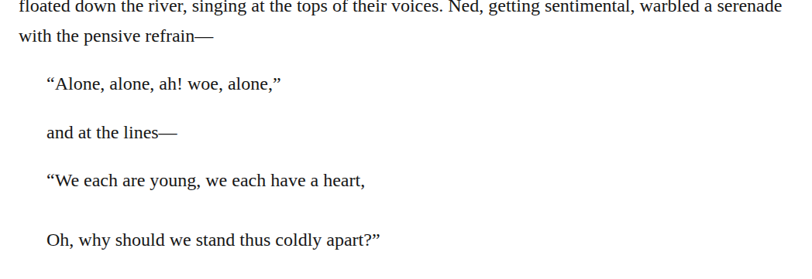

# Quoted song inflection: detailed changes

## crinkle-song-markup

Source: [chapter 1, line 111](https://github.com/standardebooks/louisa-may-alcott_little-women/blob/38695106591f6060142dd1ad4da1d2aeded8ab8f/src/epub/text/chapter-1.xhtml#L111).

Occurrences: 2.

<code>&lt;blockquote&gt;</code> → <code>&lt;blockquote epub:type="z3998:song"&gt;</code>.

[Exact patch](../../changes/crinkle-song-markup/baseline.patch).

Proposed commit:

```text
Quoted song inflection (chapter 1, line 111)
```

## git-09-current-proposal-003

Source: [chapter 33, line 32](https://github.com/standardebooks/louisa-may-alcott_little-women/blob/38695106591f6060142dd1ad4da1d2aeded8ab8f/src/epub/text/chapter-33.xhtml#L32).

Occurrences: 1.

<code>&lt;blockquote&gt;</code> → <code>&lt;blockquote epub:type="z3998:song"&gt;</code>.

[Exact patch](../../changes/git-09-current-proposal-003/baseline.patch).

Proposed commit:

```text
Quoted song inflection (chapter 33, line 32)
```

## ir51-serenade-semantics

Source: [chapter 12, line 202](https://github.com/standardebooks/louisa-may-alcott_little-women/blob/38695106591f6060142dd1ad4da1d2aeded8ab8f/src/epub/text/chapter-12.xhtml#L202).

Occurrences: 1.

<code>&lt;blockquote&gt;&#10;				&lt;p&gt;“Alone, alone, ah! woe, alone,”&lt;/p&gt;&#10;			&lt;/blockquote&gt;&#10;			&lt;p class="continued"&gt;and at the lines⁠—&lt;/p&gt;&#10;			&lt;blockquote epub:type="z3998:verse"&gt;</code> → <code>&lt;blockquote epub:type="z3998:song"&gt;&#10;				&lt;p&gt;“Alone, alone, ah! woe, alone,”&lt;/p&gt;&#10;			&lt;/blockquote&gt;&#10;			&lt;p class="continued"&gt;and at the lines⁠—&lt;/p&gt;&#10;			&lt;blockquote epub:type="z3998:song"&gt;</code>.

[Exact patch](../../changes/ir51-serenade-semantics/baseline.patch).

Proposed commit:

```text
Update ““Alone, alone, ah! woe, alone,” and at the lines⁠—” markup (chapter 12, line 202)
```



[Standard Ebooks digital text — Ebook context render — chapter 12 — full context render](../../assets/image-0215.png).
