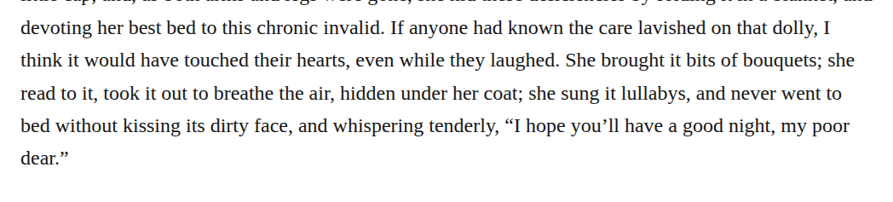

# Spelling lullabies

In chapter 4, change “she sung it lullabys” to “she sung it lullabies”. The noun denotes multiple songs; the standard plural spelling preserves pronunciation and sense under the sound-alike modernization guidance. This is a discretionary modernization with medium confidence and leaves the verb sung unchanged.

| Location | Current → proposed | Exact patch |
| --- | --- | --- |
| [chapter 4, line 43](https://github.com/standardebooks/louisa-may-alcott_little-women/blob/38695106591f6060142dd1ad4da1d2aeded8ab8f/src/epub/text/chapter-4.xhtml#L43) | <code>lullabys,</code> → <code>lullabies,</code> | [Patch](../../changes/lullabies4/baseline.patch) |

[Complete changes and proposed messages](appendix.md).

[Standard Ebooks digital text — Ebook context render — chapter 4 — full context render](../../assets/image-0225.png).
