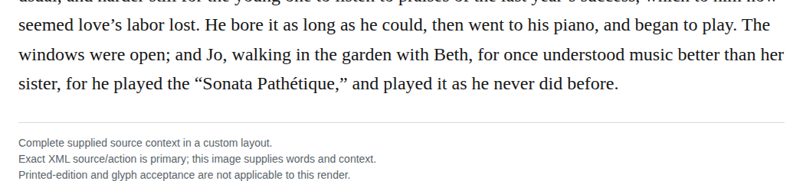

# Standalone sonata title

In chapter 35, replace quotation marks around Sonata Pathétique with italic work-title markup, placing the following comma outside the title. The piano-performance context identifies a standalone musical work, so the long-work title rule applies (required; high confidence). In the composed proposal only Pathétique carries French language markup under the owner’s provisional permission for selected work titles.

| Location | Current → proposed | Exact patch |
| --- | --- | --- |
| [chapter 35, line 82](https://github.com/standardebooks/louisa-may-alcott_little-women/blob/38695106591f6060142dd1ad4da1d2aeded8ab8f/src/epub/text/chapter-35.xhtml#L82) | <code>“Sonata Pathétique,”</code> → <code>&lt;i epub:type="se:name.music"&gt;Sonata Pathétique&lt;/i&gt;,</code> | [Patch](../../changes/sonata-pathetique35/baseline.patch) |

[Complete changes and proposed messages](appendix.md).

[Standard Ebooks digital text — Ebook context render — chapter 35 — full context render](../../assets/image-0278.png).
