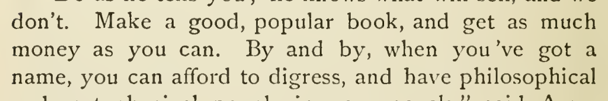

# Restore integrated temporal-clause punctuation

In chapter 27, change “when, you’ve got a name” to “when you’ve got a name.” The cited 1915 scan (p. 338) supports the uninterrupted temporal clause; PG37106 retains the comma. A rhetorical pause is conceivable in isolation, but the retained source comparison and local syntax favor this high-confidence restoration. This does not identify the original transcription event.

| Location | Current → proposed | Exact patch |
| --- | --- | --- |
| [chapter 27, line 46](https://github.com/standardebooks/louisa-may-alcott_little-women/blob/38695106591f6060142dd1ad4da1d2aeded8ab8f/src/epub/text/chapter-27.xhtml#L46) | <code>when,</code> → <code>when</code> | [Patch](../../changes/v3-group-18/baseline.patch) |

[Complete changes and proposed messages](appendix.md).

[1915 Little, Brown (Smith illustrations) — 1915 Little, Brown (Smith illustrations) — full page](../../assets/image-0310.png).
