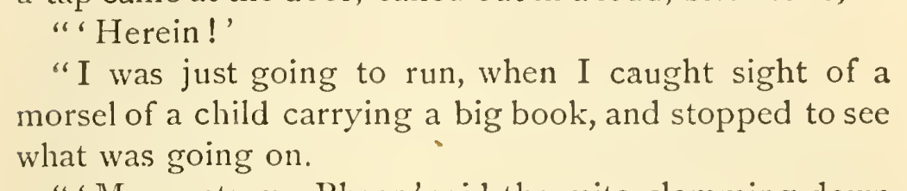
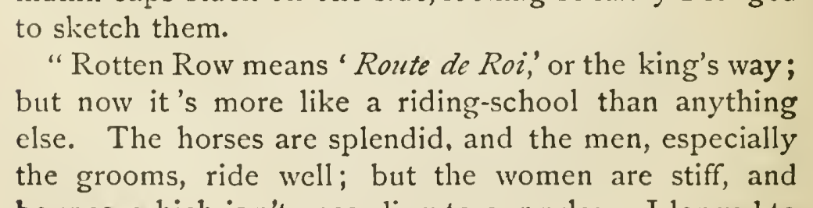

# actual foreign language

Mark Bhaer’s reply Herein as German with &lt;i xml:lang="de"&gt; and add xml:lang="fr" to the existing Route de Roi italic carrier. The door-entry context identifies the German invitation; Amy supplies an English gloss for the French phrase. Manual §§5.3.1 and 8.2.9 support these two local corrections. Preserve the wording Route de Roi without endorsing its etymology.

| Location | Current → proposed | Exact patch |
| --- | --- | --- |
| [chapter 33, line 36](https://github.com/standardebooks/louisa-may-alcott_little-women/blob/38695106591f6060142dd1ad4da1d2aeded8ab8f/src/epub/text/chapter-33.xhtml#L36) | <code>‘Herein!’&lt;/p&gt;</code> → <code>‘&lt;i xml:lang="de"&gt;Herein!&lt;/i&gt;’&lt;/p&gt;</code> | [Patch](../changes/herein/baseline.patch) |
| [chapter 31, line 44](https://github.com/standardebooks/louisa-may-alcott_little-women/blob/38695106591f6060142dd1ad4da1d2aeded8ab8f/src/epub/text/chapter-31.xhtml#L44) | <code>‘&lt;i&gt;Route</code> → <code>‘&lt;i xml:lang="fr"&gt;Route</code> | [Patch](../changes/route-de-roi/baseline.patch) |

[Complete changes and proposed messages](../briefs/rule-actual-foreign-language/appendix.md).

[1915 Little, Brown (Smith illustrations) — 1915 Little, Brown (Smith illustrations), physical page 443 — full page](../assets/image-0203.png).

[1915 Little, Brown (Smith illustrations) — 1915 Little, Brown (Smith illustrations), physical page 414 — full page](../assets/image-0266.png).

