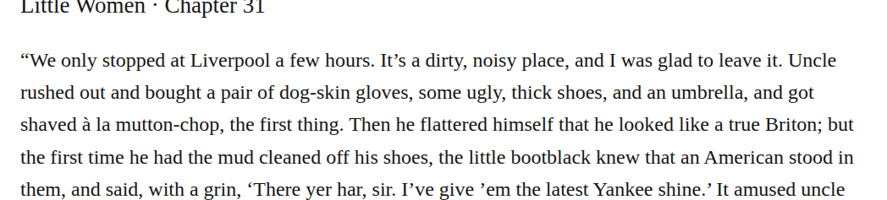

# compound dogskin

Optionally change “dog-skin gloves” to “dogskin gloves” in chapter 31. The retained dictionary observation includes the matching material noun and glove usage. This medium-confidence editorial modernization preserves the meaning; it establishes neither a transcription error nor the actual material of the gloves.

| Location | Current → proposed | Exact patch |
| --- | --- | --- |
| [chapter 31, line 36](https://github.com/standardebooks/louisa-may-alcott_little-women/blob/38695106591f6060142dd1ad4da1d2aeded8ab8f/src/epub/text/chapter-31.xhtml#L36) | <code>dog-skin</code> → <code>dogskin</code> | [Patch](../changes/dogskin/baseline.patch) |

[Complete changes and proposed messages](../briefs/rule-compound-dogskin/appendix.md).

[Standard Ebooks digital text — Ebook context render — chapter 31 — full context render](../assets/image-0087.png).

