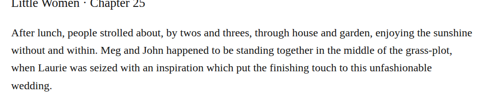

# compound grassplot

Optionally change “grass-plot” to “grassplot” in chapter 25. The retained closed-headword observation fits the grassy area where Meg and John stand. Medium-confidence editorial modernization; retaining the clear existing form is defensible, and no print-history claim is required.

| Location | Current → proposed | Exact patch |
| --- | --- | --- |
| [chapter 25, line 46](https://github.com/standardebooks/louisa-may-alcott_little-women/blob/38695106591f6060142dd1ad4da1d2aeded8ab8f/src/epub/text/chapter-25.xhtml#L46) | <code>grass-plot,</code> → <code>grassplot,</code> | [Patch](../changes/chapter25-grassplot/baseline.patch) |

[Complete changes and proposed messages](../briefs/rule-compound-grassplot/appendix.md).

[Standard Ebooks digital text — Ebook context render — chapter 25 — full context render](../assets/image-0041.png).

