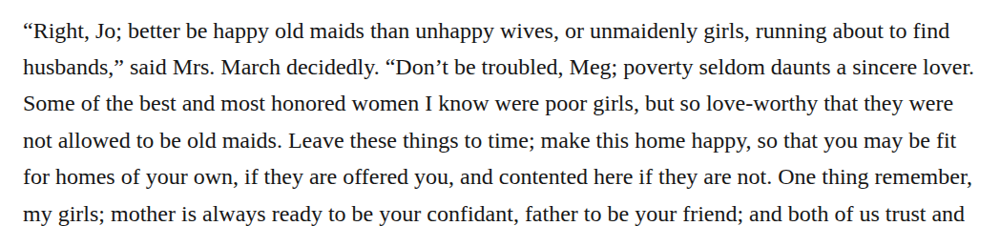

# compound loveworthy

Optionally change “love-worthy” to “loveworthy” in Mrs. March’s chapter 9 speech. The retained sense “deserving love” fits her description. Medium-confidence editorial modernization; the current hyphenated form is also clear, and no intended historical spelling is reconstructed.

| Location | Current → proposed | Exact patch |
| --- | --- | --- |
| [chapter 9, line 162](https://github.com/standardebooks/louisa-may-alcott_little-women/blob/38695106591f6060142dd1ad4da1d2aeded8ab8f/src/epub/text/chapter-9.xhtml#L162) | <code>love-worthy</code> → <code>loveworthy</code> | [Patch](../changes/loveworthy9/baseline.patch) |

[Complete changes and proposed messages](../briefs/rule-compound-loveworthy/appendix.md).

[Standard Ebooks digital text — Ebook context render — chapter 9 — full context render](../assets/image-0223.png).

