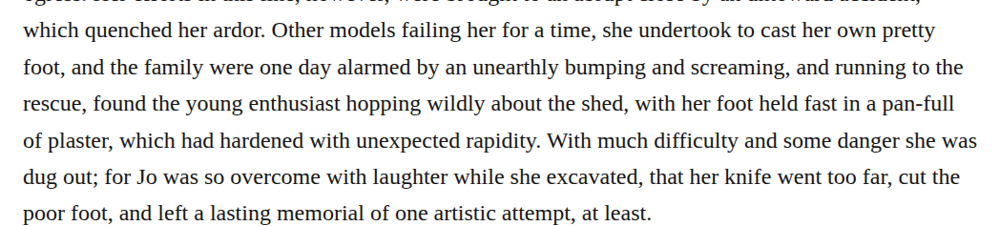

# compound panful

Optionally change “a pan-full of plaster” to “a panful of plaster” in chapter 26. The retained basic dictionary definition matches a pan’s capacity. The production guide permits this meaning-preserving modernization. High confidence in the recommendation does not make it required; retain Editorial disclosure.

| Location | Current → proposed | Exact patch |
| --- | --- | --- |
| [chapter 26, line 16](https://github.com/standardebooks/louisa-may-alcott_little-women/blob/38695106591f6060142dd1ad4da1d2aeded8ab8f/src/epub/text/chapter-26.xhtml#L16) | <code>pan-full</code> → <code>panful</code> | [Patch](../changes/chapter26-panful/baseline.patch) |

[Complete changes and proposed messages](../briefs/rule-compound-panful/appendix.md).

[Standard Ebooks digital text — Ebook context render — chapter 26 — full context render](../assets/image-0045.png).

