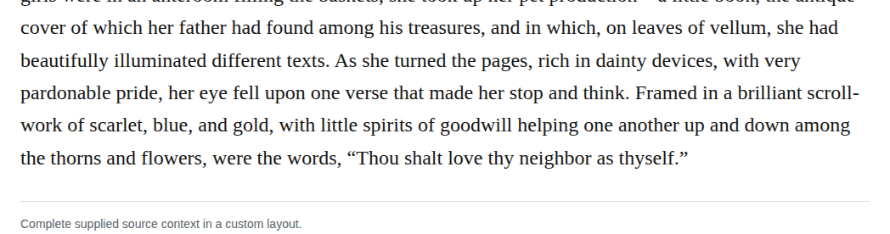

# compound scrollwork

In chapter 30, change “scroll-work” to “scrollwork” for the colored ornament around Amy’s illuminated verse. The retained dictionary report includes this general ornamental sense, beyond its woodworking use. Recommend the closed form as an optional Editorial modernization at medium confidence; the existing hyphenated form remains defensible.

| Location | Current → proposed | Exact patch |
| --- | --- | --- |
| [chapter 30, line 32](https://github.com/standardebooks/louisa-may-alcott_little-women/blob/38695106591f6060142dd1ad4da1d2aeded8ab8f/src/epub/text/chapter-30.xhtml#L32) | <code>scroll-work</code> → <code>scrollwork</code> | [Patch](../changes/scrollwork/baseline.patch) |

[Complete changes and proposed messages](../briefs/rule-compound-scrollwork/appendix.md).

[Standard Ebooks digital text — Ebook context render — chapter 30 — full context render](../assets/image-0272.png).

