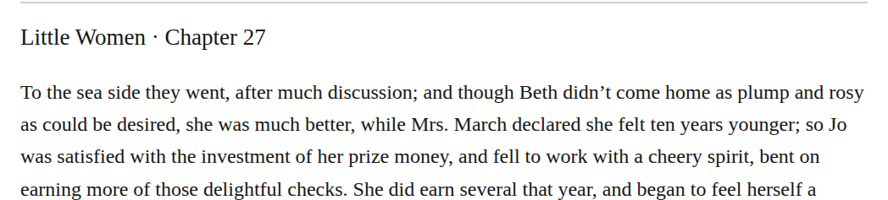

# compound seaside

Change “To the sea side they went” to “To the seaside they went” in chapter 27. Jo’s preceding plan already sends Beth and her mother “to the seaside,” so the closed spelling gives the same destination a consistent form. This is a high-confidence, optional Editorial choice under the owner’s modernization preference; the hyphenated-compound exception does not directly cover this open compound.

| Location | Current → proposed | Exact patch |
| --- | --- | --- |
| [chapter 27, line 37](https://github.com/standardebooks/louisa-may-alcott_little-women/blob/38695106591f6060142dd1ad4da1d2aeded8ab8f/src/epub/text/chapter-27.xhtml#L37) | <code>sea side</code> → <code>seaside</code> | [Patch](../changes/chapter27-seaside/baseline.patch) |

[Complete changes and proposed messages](../briefs/rule-compound-seaside/appendix.md).

[Standard Ebooks digital text — Ebook context render — chapter 27 — full context render](../assets/image-0047.png).

