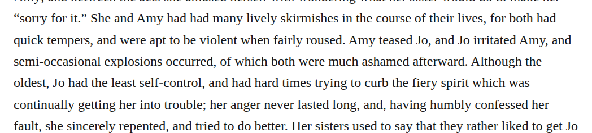

# compound semioccasional

Close “semi-occasional” in chapter 8 and “semi-occasionally” in chapter 27 to “semioccasional” and “semioccasionally.” The retained Merriam-Webster entry is reported to supply both the adjective and adverb, and both passages retain their comic sense of infrequent events. These are medium-confidence, optional Editorial changes under the qualified basic-search permission; the report identifies the public dictionary interface, not a verified backend tier.

| Location | Current → proposed | Exact patch |
| --- | --- | --- |
| [chapter 8, line 30](https://github.com/standardebooks/louisa-may-alcott_little-women/blob/38695106591f6060142dd1ad4da1d2aeded8ab8f/src/epub/text/chapter-8.xhtml#L30) | <code>semi-occasional</code> → <code>semioccasional</code> | [Patch](../changes/semioccasional8/baseline.patch) |
| [chapter 27](https://github.com/standardebooks/louisa-may-alcott_little-women/blob/38695106591f6060142dd1ad4da1d2aeded8ab8f/src/epub/text/chapter-27.xhtml) | <code>semi-occasionally,</code> → <code>semioccasionally,</code> | [Patch](../changes/compound-semioccasional-chapter-27-byte-1548/baseline.patch) |

[Complete changes and proposed messages](../briefs/rule-compound-semioccasional/appendix.md).

[Standard Ebooks digital text — Ebook context render — chapter 8 — full context render](../assets/image-0276.png).

