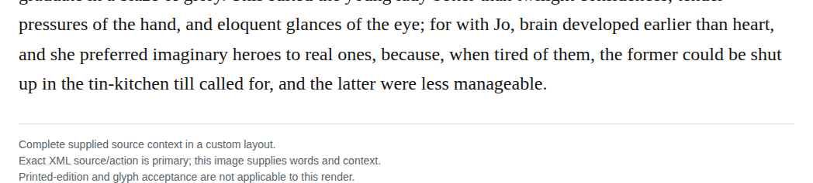
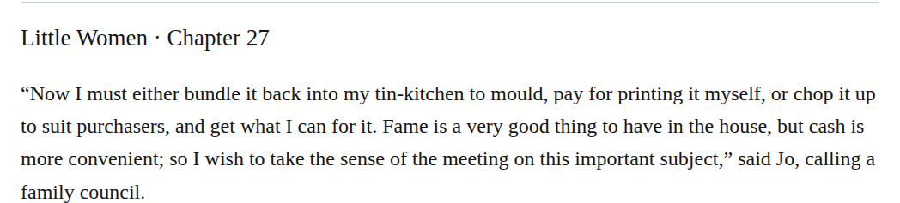

# compound tin kitchen

Change “tin-kitchen” to “tin kitchen” in chapters 27 and 32 to match the open spelling reported for Jo’s manuscript receptacle in chapters 14 and 24. The manuscript-storage and imaginary-heroes contexts support the same usage. This is a recommended Editorial consistency change under the mismatched-dashes guidance, with medium confidence for chapter 27 and high confidence for chapter 32. It does not establish the object’s manufacture or an original authorial spelling.

| Location | Current → proposed | Exact patch |
| --- | --- | --- |
| [chapter 32, line 38](https://github.com/standardebooks/louisa-may-alcott_little-women/blob/38695106591f6060142dd1ad4da1d2aeded8ab8f/src/epub/text/chapter-32.xhtml#L38) | <code>tin-kitchen</code> → <code>tin kitchen</code> | [Patch](../changes/tin-kitchen32/baseline.patch) |
| [chapter 27, line 40](https://github.com/standardebooks/louisa-may-alcott_little-women/blob/38695106591f6060142dd1ad4da1d2aeded8ab8f/src/epub/text/chapter-27.xhtml#L40) | <code>tin-kitchen</code> → <code>tin kitchen</code> | [Patch](../changes/chapter27-tin-kitchen/baseline.patch) |

[Complete changes and proposed messages](../briefs/rule-compound-tin-kitchen/appendix.md).

[Standard Ebooks digital text — Ebook context render — chapter 32 — full context render](../assets/image-0282.png).

[Standard Ebooks digital text — Ebook context render — chapter 27 — full context render](../assets/image-0049.png).

