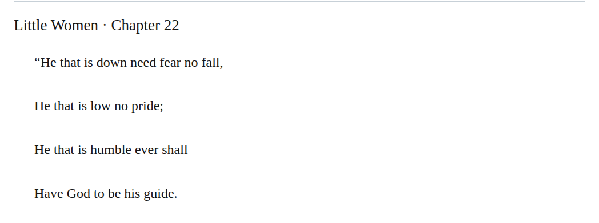
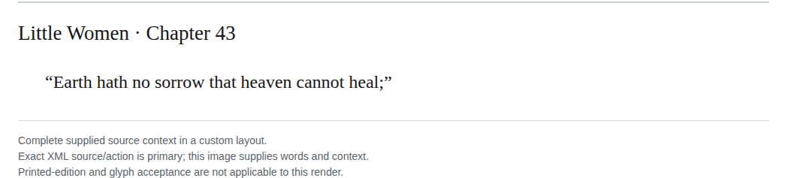

# explicit hymn inflection

Identify the explicitly named hymns in chapters 22 and 43 with z3998:hymn. In chapter 22 replace poem and extend the four existing verse-layout selector groups to hymn; in chapter 43 add hymn alongside song. The preceding narration calls each a hymn, so the Manual hymn rule applies. This proposal leaves the sung semicolon unchanged.

| Location | Current → proposed | Exact patch |
| --- | --- | --- |
| [local.css, line 52](https://github.com/standardebooks/louisa-may-alcott_little-women/blob/38695106591f6060142dd1ad4da1d2aeded8ab8f/src/epub/css/local.css#L52) | <code>[epub&#124;type~="z3998:poem"]</code> → <code>[epub&#124;type~="z3998:hymn"] p,&#10;[epub&#124;type~="z3998:poem"]</code> | [Patch](../changes/git-09-current-proposal-002/baseline.patch) |
| [chapter 43, line 131](https://github.com/standardebooks/louisa-may-alcott_little-women/blob/38695106591f6060142dd1ad4da1d2aeded8ab8f/src/epub/text/chapter-43.xhtml#L131) | <code>&lt;blockquote epub:type="z3998:song"&gt;</code> → <code>&lt;blockquote epub:type="z3998:song z3998:hymn"&gt;</code> | [Patch](../changes/git07-current-ch43-explicit-hymn-carrier/baseline.patch) |

[Complete changes and proposed messages](../briefs/rule-explicit-hymn-inflection/appendix.md).

[Standard Ebooks digital text — Ebook context render — chapter 22 — full context render](../assets/image-0129.png).

[Standard Ebooks digital text — Ebook context render — chapter 43 — full context render](../assets/image-0195.png).

