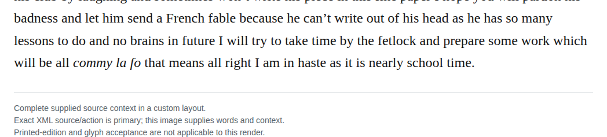

# Fictional unpunctuated letter period

In chapter 10, remove the period after “nearly school time” from Winkle’s otherwise unpunctuated letter body. The surrounding joke about his punctuation supports extending that pattern through the final words, while leaving the salutation and closing punctuation intact. This is a locally well-supported, optional Editorial revision; the existing terminal period is also defensible, and source restoration has not been established.

| Location | Current → proposed | Exact patch |
| --- | --- | --- |
| [chapter 10, line 162](https://github.com/standardebooks/louisa-may-alcott_little-women/blob/38695106591f6060142dd1ad4da1d2aeded8ab8f/src/epub/text/chapter-10.xhtml#L162) | <code>time.&lt;/p&gt;</code> → <code>time&lt;/p&gt;</code> | [Patch](../changes/generic-ch10-school-time-period/baseline.patch) |

[Complete changes and proposed messages](../briefs/rule-fictional-unpunctuated-letter-period/appendix.md).

[Standard Ebooks digital text — Ebook context render — chapter 10 — full context render](../assets/image-0107.png).

