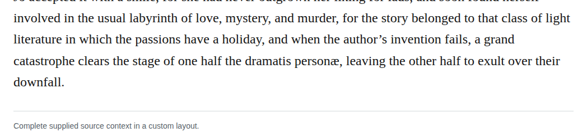

# latin presentation ligature

In chapter 27, expand “dramatis personæ” to “dramatis personae.” The supplied ligature rule expressly requires expansion of presentation ligatures in Latin; its exception for meaningful ligatures in languages such as French does not apply. The exact change preserves the Latin phrase and its meaning. This is a high-confidence, required editorial-style correction, not a demonstrated source-restoration claim.

| Location | Current → proposed | Exact patch |
| --- | --- | --- |
| [chapter 27, line 20](https://github.com/standardebooks/louisa-may-alcott_little-women/blob/38695106591f6060142dd1ad4da1d2aeded8ab8f/src/epub/text/chapter-27.xhtml#L20) | <code>personæ,</code> → <code>personae,</code> | [Patch](../changes/candidate29-ch27-latin-ligature-expansion/baseline.patch) |

[Complete changes and proposed messages](../briefs/rule-latin-presentation-ligature/appendix.md).

[Standard Ebooks digital text — Ebook context render — chapter 27 — full context render](../assets/image-0020.png).

