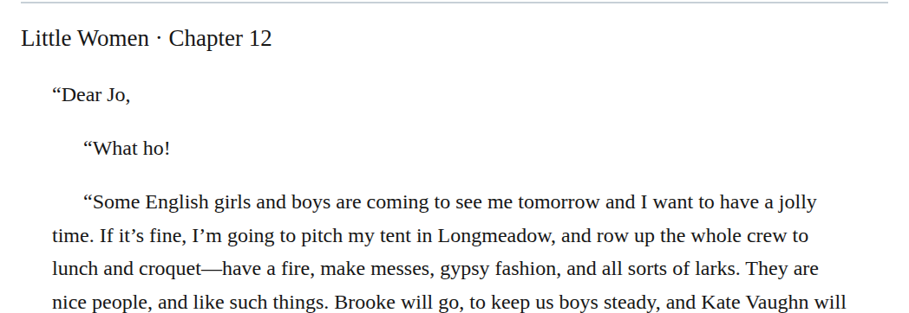

# letter closing compound restructuring

Group Laurie’s chapter 12 closing in a &lt;footer role="presentation"&gt; and one valediction paragraph, retaining its three lines with &lt;br/&gt; and marking the signature inline. Read “In a tearing hurry, Yours ever, Laurie” as one elliptical subscription. The letter-footer and single-clause rules then apply. A separate first closing paragraph is also a plausible reading, so confidence is medium; this is not a claim about printed paragraph restoration.

| Location | Current → proposed | Exact patch |
| --- | --- | --- |
| [chapter 12, line 36](https://github.com/standardebooks/louisa-may-alcott_little-women/blob/38695106591f6060142dd1ad4da1d2aeded8ab8f/src/epub/text/chapter-12.xhtml#L36) | <code>&lt;p epub:type="z3998:valediction"&gt;“In a tearing hurry,&lt;/p&gt;&#10;				&lt;p epub:type="z3998:valediction"&gt;“Yours ever,&lt;/p&gt;&#10;				&lt;p epub:type="z3998:signature"&gt;“Laurie.”&lt;/p&gt;</code> → <code>&lt;footer role="presentation"&gt;&#10;					&lt;p epub:type="z3998:valediction"&gt;“In a tearing hurry,&lt;br/&gt;&#10;					Yours ever,&lt;br/&gt;&#10;					&lt;span epub:type="z3998:signature"&gt;Laurie.&lt;/span&gt;”&lt;/p&gt;&#10;				&lt;/footer&gt;</code> | [Patch](../changes/current-laurie-closing-footer-and-single-clause/baseline.patch) |

[Complete changes and proposed messages](../briefs/rule-letter-closing-compound-restructuring/appendix.md).

[Standard Ebooks digital text — Ebook context render — chapter 12 — full context render](../assets/image-0071.png).

