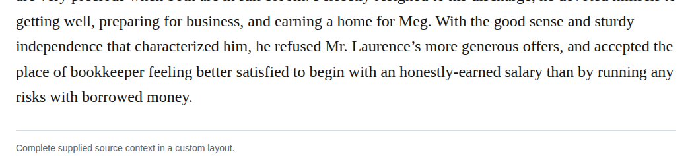
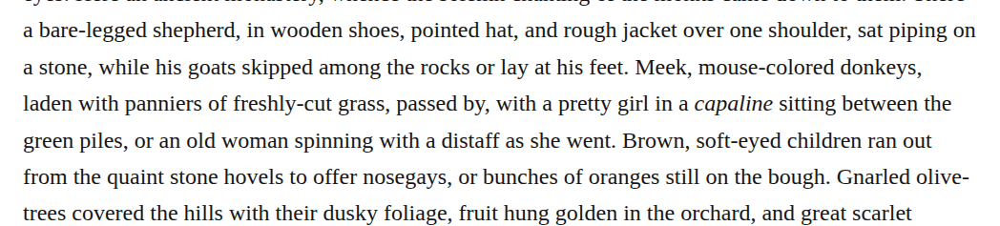

# ly adverb participle opening

Open honestly-earned to honestly earned in chapter 24 and freshly-cut to freshly cut in chapter 39. In both phrases an -ly adverb modifies a participle, so opening preserves grammar and meaning. The supplied Chicago guidance favors open forms, while the production guide generally retains compound spacing; no mandatory precedence has been established here. Recommend these two modernizations as discretionary editorial choices with medium confidence.

| Location | Current → proposed | Exact patch |
| --- | --- | --- |
| [chapter 24, line 20](https://github.com/standardebooks/louisa-may-alcott_little-women/blob/38695106591f6060142dd1ad4da1d2aeded8ab8f/src/epub/text/chapter-24.xhtml#L20) | <code>honestly-earned</code> → <code>honestly earned</code> | [Patch](../changes/generic-ch24-honestly-earned-style/baseline.patch) |
| [chapter 39, line 22](https://github.com/standardebooks/louisa-may-alcott_little-women/blob/38695106591f6060142dd1ad4da1d2aeded8ab8f/src/epub/text/chapter-39.xhtml#L22) | <code>freshly-cut</code> → <code>freshly cut</code> | [Patch](../changes/generic-ch39-open-freshly-cut/baseline.patch) |

[Complete changes and proposed messages](../briefs/rule-ly-adverb-participle-opening/appendix.md).

[Standard Ebooks digital text — Ebook context render — chapter 24 — full context render](../assets/image-0109.png).

[Standard Ebooks digital text — Ebook context render — chapter 39 — full context render](../assets/image-0117.png).

