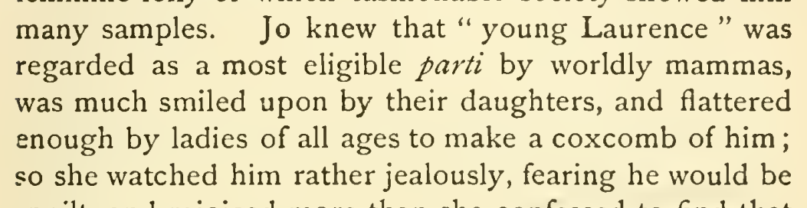

# parti language correction

Replace xml:lang="x-onglish" with xml:lang="fr" on parti in chapter 32. The narrator’s “most eligible parti” describes a marriage prospect and supports the French reading. An English borrowing remains plausible, so this is a discretionary, medium-confidence interpretation. Preserve the word and existing italics.

| Location | Current → proposed | Exact patch |
| --- | --- | --- |
| [chapter 32, line 69](https://github.com/standardebooks/louisa-may-alcott_little-women/blob/38695106591f6060142dd1ad4da1d2aeded8ab8f/src/epub/text/chapter-32.xhtml#L69) | <code>&lt;i xml:lang="x-onglish"&gt;parti&lt;/i&gt;</code> → <code>&lt;i xml:lang="fr"&gt;parti&lt;/i&gt;</code> | [Patch](../changes/parti/baseline.patch) |

[Complete changes and proposed messages](../briefs/rule-parti-language-correction/appendix.md).

[1915 Little, Brown (Smith illustrations) — 1915 Little, Brown (Smith illustrations), physical page 433 — full page](../assets/image-0250.png).

