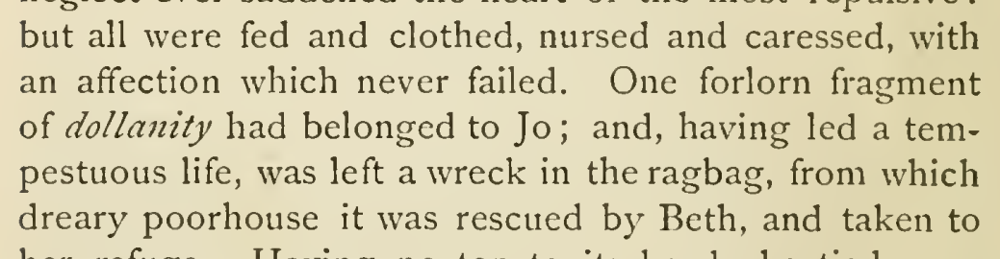
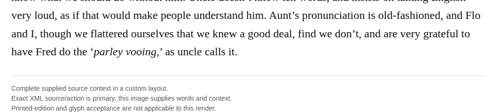

# represented english language carrier

Remove the private language overrides from deggerredation, dollanity, dewote, parley vooing and went, allowing them to inherit English while retaining their spellings and italics. The contexts support English wordplay or represented pronunciation. These are optional semantic improvements, not invalid-tag repairs; French imitation remains a competing reading for parley vooing.

| Location | Current → proposed | Exact patch |
| --- | --- | --- |
| [chapter 4, line 49](https://github.com/standardebooks/louisa-may-alcott_little-women/blob/38695106591f6060142dd1ad4da1d2aeded8ab8f/src/epub/text/chapter-4.xhtml#L49) | <code>&lt;i xml:lang="x-fronch"&gt;deggerredation&lt;/i&gt;</code> → <code>&lt;i&gt;deggerredation&lt;/i&gt;</code> | [Patch](../changes/deggerredation-language-tag/baseline.patch) |
| [chapter 4, line 43](https://github.com/standardebooks/louisa-may-alcott_little-women/blob/38695106591f6060142dd1ad4da1d2aeded8ab8f/src/epub/text/chapter-4.xhtml#L43) | <code>&lt;i xml:lang="x-fronch"&gt;dollanity&lt;/i&gt;</code> → <code>&lt;i&gt;dollanity&lt;/i&gt;</code> | [Patch](../changes/dollanity/baseline.patch) |
| [chapter 31, line 56](https://github.com/standardebooks/louisa-may-alcott_little-women/blob/38695106591f6060142dd1ad4da1d2aeded8ab8f/src/epub/text/chapter-31.xhtml#L56) | <code>&lt;i xml:lang="x-fronch"&gt;parley vooing&lt;/i&gt;</code> → <code>&lt;i&gt;parley vooing&lt;/i&gt;</code> | [Patch](../changes/typed-carrier-parallel-occurrences-recovery-38/baseline.patch) |
| [chapter 32, line 53](https://github.com/standardebooks/louisa-may-alcott_little-women/blob/38695106591f6060142dd1ad4da1d2aeded8ab8f/src/epub/text/chapter-32.xhtml#L53) | <code>&lt;i xml:lang="x-onglish"&gt;went&lt;/i&gt;</code> → <code>&lt;i&gt;went&lt;/i&gt;</code> | [Patch](../changes/typed-carrier-parallel-occurrences-recovery-52/baseline.patch) |
| [chapter 10, line 326](https://github.com/standardebooks/louisa-may-alcott_little-women/blob/38695106591f6060142dd1ad4da1d2aeded8ab8f/src/epub/text/chapter-10.xhtml#L326) | <code>&lt;i xml:lang="x-onglish"&gt;dewote&lt;/i&gt;</code> → <code>&lt;i&gt;dewote&lt;/i&gt;</code> | [Patch](../changes/git05-discretionary-3/baseline.patch) |

[Complete changes and proposed messages](../briefs/rule-represented-english-language-carrier/appendix.md).

[1915 Little, Brown (Smith illustrations) — 1915 Little, Brown (Smith illustrations), physical page 62 — full page](../assets/image-0089.png).

[Standard Ebooks digital text — Ebook context render — chapter 31 — full context render](../assets/image-0304.png).

