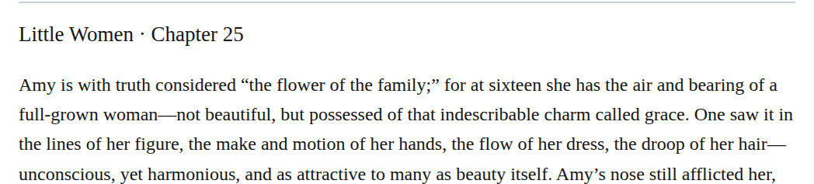
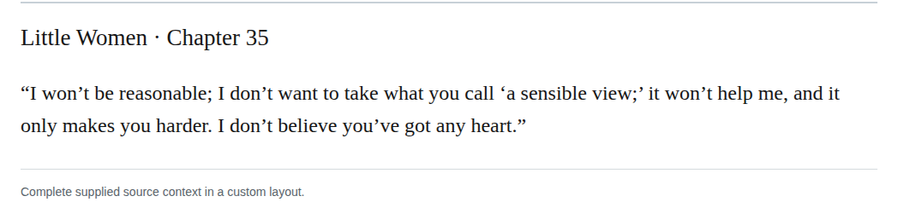

# semicolon quotation ownership

Apply Manual §8.7.2.1 at the 26 listed boundaries: a semicolon ending spoken dialogue goes inside its closing quotation mark; otherwise it goes outside. Six completed utterances take the mark inside; the other twenty are quoted terms, titles, inscriptions, embedded words, private thought or prospective/remembered wording whose surrounding sentence owns the separator. The chapter 34 passage explicitly says Jo thought to herself; the chapter 41 answer was never spoken. Preserve nested quotation boundaries. These are required technical corrections, with high confidence. Sung-word cases and speech-tag punctuation questions are outside this group.

This group contains 26 changes. The 12 representative examples below are spaced across the change list; the appendix retains every change and proposed commit message.

| Location | Current → proposed | Exact patch |
| --- | --- | --- |
| [chapter 41, line 14](https://github.com/standardebooks/louisa-may-alcott_little-women/blob/38695106591f6060142dd1ad4da1d2aeded8ab8f/src/epub/text/chapter-41.xhtml#L14) | <code>you;”</code> → <code>you”;</code> | [Patch](../changes/semicolon-remembered-words/baseline.patch) |
| [chapter 14, line 137](https://github.com/standardebooks/louisa-may-alcott_little-women/blob/38695106591f6060142dd1ad4da1d2aeded8ab8f/src/epub/text/chapter-14.xhtml#L137) | <code>doin’s;”</code> → <code>doin’s”;</code> | [Patch](../changes/semicolon-jo-doings/baseline.patch) |
| [chapter 43, line 103](https://github.com/standardebooks/louisa-may-alcott_little-women/blob/38695106591f6060142dd1ad4da1d2aeded8ab8f/src/epub/text/chapter-43.xhtml#L103) | <code>son;”</code> → <code>son”;</code> | [Patch](../changes/semicolon-procession-designations-site-2/baseline.patch) |
| [chapter 22, line 14](https://github.com/standardebooks/louisa-may-alcott_little-women/blob/38695106591f6060142dd1ad4da1d2aeded8ab8f/src/epub/text/chapter-22.xhtml#L14) | <code>dear;”</code> → <code>dear”;</code> | [Patch](../changes/semicolon-the-dear/baseline.patch) |
| [chapter 29, line 38](https://github.com/standardebooks/louisa-may-alcott_little-women/blob/38695106591f6060142dd1ad4da1d2aeded8ab8f/src/epub/text/chapter-29.xhtml#L38) | <code>girl;’</code> → <code>girl’;</code> | [Patch](../changes/semicolon-charming-girl/baseline.patch) |
| [chapter 16, line 32](https://github.com/standardebooks/louisa-may-alcott_little-women/blob/38695106591f6060142dd1ad4da1d2aeded8ab8f/src/epub/text/chapter-16.xhtml#L32) | <code>busy;’</code> → <code>busy’;</code> | [Patch](../changes/semicolon-hope-motto/baseline.patch) |
| [chapter 33, line 19](https://github.com/standardebooks/louisa-may-alcott_little-women/blob/38695106591f6060142dd1ad4da1d2aeded8ab8f/src/epub/text/chapter-33.xhtml#L19) | <code>Pigs;’</code> → <code>Pigs’;</code> | [Patch](../changes/semicolon-seven-pigs-title/baseline.patch) |
| [chapter 35, line 62](https://github.com/standardebooks/louisa-may-alcott_little-women/blob/38695106591f6060142dd1ad4da1d2aeded8ab8f/src/epub/text/chapter-35.xhtml#L62) | <code>view;’</code> → <code>view’;</code> | [Patch](../changes/d42-sensible-inner-semicolon/baseline.patch) |
| [chapter 2, line 109](https://github.com/standardebooks/louisa-may-alcott_little-women/blob/38695106591f6060142dd1ad4da1d2aeded8ab8f/src/epub/text/chapter-2.xhtml#L109) | <code>it”;</code> → <code>it;”</code> | [Patch](../changes/quotation195-a-022/baseline.patch) |
| [chapter 3, line 92](https://github.com/standardebooks/louisa-may-alcott_little-women/blob/38695106591f6060142dd1ad4da1d2aeded8ab8f/src/epub/text/chapter-3.xhtml#L92) | <code>hard”;</code> → <code>hard;”</code> | [Patch](../changes/quotation195-a-044/baseline.patch) |
| [chapter 3, line 127](https://github.com/standardebooks/louisa-may-alcott_little-women/blob/38695106591f6060142dd1ad4da1d2aeded8ab8f/src/epub/text/chapter-3.xhtml#L127) | <code>all”;</code> → <code>all;”</code> | [Patch](../changes/ch3-dialogue-thats-all-semicolon/baseline.patch) |
| [chapter 41](https://github.com/standardebooks/louisa-may-alcott_little-women/blob/38695106591f6060142dd1ad4da1d2aeded8ab8f/src/epub/text/chapter-41.xhtml) | <code>you;”</code> → <code>you”;</code> | [Patch](../changes/semicolon-quotation-ownership-chapter-41-byte-13113/baseline.patch) |

[Complete changes and proposed messages](../briefs/rule-semicolon-quotation-ownership/appendix.md).

[Standard Ebooks digital text — Ebook context render — chapter 25 — full context render](../assets/image-0077.png).

[Standard Ebooks digital text — Ebook context render — chapter 35 — full context render](../assets/image-0079.png).

