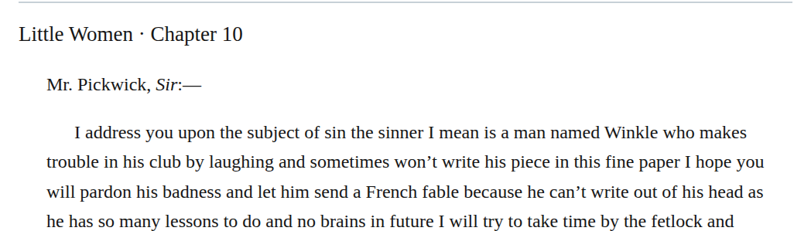

# single clause letter closing

In chapter 10, “Yours respectably, N. Winkle” forms one valediction/signature clause. Put it in one paragraph, with a br before the signature and a z3998:signature span around N. Winkle. This implements the single-clause closing rule (required; high confidence). The composed Winkle persona span nests inside the signature span; the closing repair does not establish the performer’s identity.

| Location | Current → proposed | Exact patch |
| --- | --- | --- |
| [chapter 10, line 164](https://github.com/standardebooks/louisa-may-alcott_little-women/blob/38695106591f6060142dd1ad4da1d2aeded8ab8f/src/epub/text/chapter-10.xhtml#L164) | <code>&lt;/p&gt;&#10;						&lt;p epub:type="z3998:signature"&gt;&lt;abbr epub:type="z3998:given-name"&gt;N.&lt;/abbr&gt; Winkle&lt;/p&gt;</code> → <code>&lt;br/&gt;&#10;							&lt;span epub:type="z3998:signature"&gt;&lt;abbr epub:type="z3998:given-name"&gt;N.&lt;/abbr&gt; Winkle&lt;/span&gt;&lt;/p&gt;</code> | [Patch](../changes/current-winkle-single-clause-closing/baseline.patch) |

[Complete changes and proposed messages](../briefs/rule-single-clause-letter-closing/appendix.md).

[Standard Ebooks digital text — Ebook context render — chapter 10 — full context render](../assets/image-0075.png).

