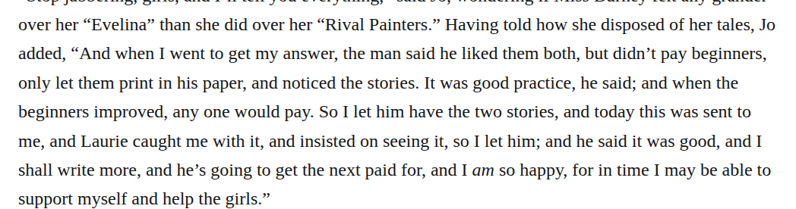

# spelling anyone

In chapter 14, change “when the beginners improved, any one would pay” to “when the beginners improved, anyone would pay”. Here the words form the ordinary indefinite pronoun, not a selection of one member from a stated set. This optional spelling modernization preserves the grammar and sense, with medium confidence. It does not imply that every open any one elsewhere should be closed.

| Location | Current → proposed | Exact patch |
| --- | --- | --- |
| [chapter 14, line 139](https://github.com/standardebooks/louisa-may-alcott_little-women/blob/38695106591f6060142dd1ad4da1d2aeded8ab8f/src/epub/text/chapter-14.xhtml#L139) | <code>any one</code> → <code>anyone</code> | [Patch](../changes/chapter14-anyone/baseline.patch) |

[Complete changes and proposed messages](../briefs/rule-spelling-anyone/appendix.md).

[Standard Ebooks digital text — Ebook context render — chapter 14 — full context render](../assets/image-0031.png).

