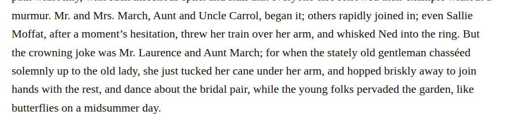
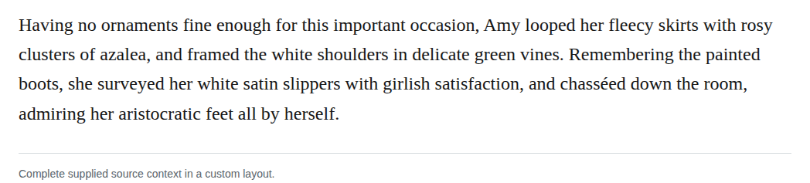

# spelling chassed

Change chasséed to chasséd at the dance and movement passages in chapters 25 and 37. The retained dictionary assessment explicitly gives this past-tense inflection, and both contexts fit the verb. The two edits preserve tense, accent, meaning and roman type, following the sound-alike spelling guidance. These are discretionary modernizations with medium confidence; retaining the understandable variant remains defensible, and no source error or earlier digital-repair history is established.

| Location | Current → proposed | Exact patch |
| --- | --- | --- |
| [chapter 25, line 47](https://github.com/standardebooks/louisa-may-alcott_little-women/blob/38695106591f6060142dd1ad4da1d2aeded8ab8f/src/epub/text/chapter-25.xhtml#L47) | <code>chasséed</code> → <code>chasséd</code> | [Patch](../changes/chapter25-chassed/baseline.patch) |
| [chapter 37, line 54](https://github.com/standardebooks/louisa-may-alcott_little-women/blob/38695106591f6060142dd1ad4da1d2aeded8ab8f/src/epub/text/chapter-37.xhtml#L54) | <code>chasséed</code> → <code>chasséd</code> | [Patch](../changes/chassed37/baseline.patch) |

[Complete changes and proposed messages](../briefs/rule-spelling-chassed/appendix.md).

[Standard Ebooks digital text — Ebook context render — chapter 25 — full context render](../assets/image-0039.png).

[Standard Ebooks digital text — Ebook context render — chapter 37 — full context render](../assets/image-0059.png).

