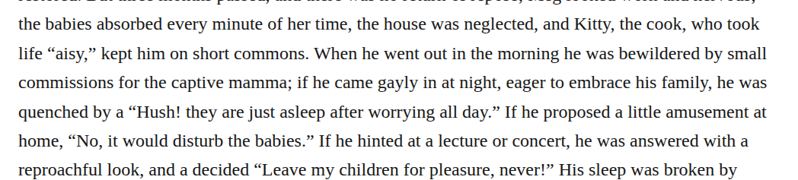
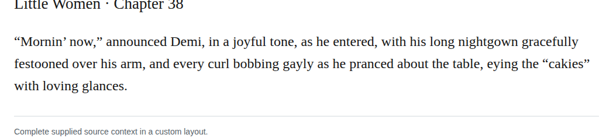

# Spelling gaily

Change gayly to gaily at the nine listed sites, including the narrative inside the chapter-10 juvenile story. The retained lexical assessment treats gayly as an accepted variant, so this is a consistent, optional same-sound spelling preference rather than correction of an error. All nine edits preserve meaning and are discretionary recommendations with medium confidence.

| Location | Current → proposed | Exact patch |
| --- | --- | --- |
| [chapter 38, line 16](https://github.com/standardebooks/louisa-may-alcott_little-women/blob/38695106591f6060142dd1ad4da1d2aeded8ab8f/src/epub/text/chapter-38.xhtml#L16) | <code>gayly</code> → <code>gaily</code> | [Patch](../changes/batch0011-gaily38-arrival/baseline.patch) |
| [chapter 38, line 65](https://github.com/standardebooks/louisa-may-alcott_little-women/blob/38695106591f6060142dd1ad4da1d2aeded8ab8f/src/epub/text/chapter-38.xhtml#L65) | <code>gayly</code> → <code>gaily</code> | [Patch](../changes/batch0011-gaily38-curls/baseline.patch) |
| [chapter 10, line 129](https://github.com/standardebooks/louisa-may-alcott_little-women/blob/38695106591f6060142dd1ad4da1d2aeded8ab8f/src/epub/text/chapter-10.xhtml#L129) | <code>gayly</code> → <code>gaily</code> | [Patch](../changes/transcription-source-gaily10/baseline.patch) |
| [chapter 27, line 15](https://github.com/standardebooks/louisa-may-alcott_little-women/blob/38695106591f6060142dd1ad4da1d2aeded8ab8f/src/epub/text/chapter-27.xhtml#L15) | <code>gayly</code> → <code>gaily</code> | [Patch](../changes/transcription-source-gaily27/baseline.patch) |
| [chapter 28, line 26](https://github.com/standardebooks/louisa-may-alcott_little-women/blob/38695106591f6060142dd1ad4da1d2aeded8ab8f/src/epub/text/chapter-28.xhtml#L26) | <code>gayly</code> → <code>gaily</code> | [Patch](../changes/transcription-source-gaily28/baseline.patch) |
| [chapter 11](https://github.com/standardebooks/louisa-may-alcott_little-women/blob/38695106591f6060142dd1ad4da1d2aeded8ab8f/src/epub/text/chapter-11.xhtml) | <code>gayly,</code> → <code>gaily,</code> | [Patch](../changes/spelling-gaily-chapter-11-byte-19910/baseline.patch) |
| [chapter 26](https://github.com/standardebooks/louisa-may-alcott_little-women/blob/38695106591f6060142dd1ad4da1d2aeded8ab8f/src/epub/text/chapter-26.xhtml) | <code>gayly</code> → <code>gaily</code> | [Patch](../changes/spelling-gaily-chapter-26-byte-21519/baseline.patch) |
| [chapter 37](https://github.com/standardebooks/louisa-may-alcott_little-women/blob/38695106591f6060142dd1ad4da1d2aeded8ab8f/src/epub/text/chapter-37.xhtml) | <code>gayly,</code> → <code>gaily,</code> | [Patch](../changes/spelling-gaily-chapter-37-byte-17424/baseline.patch) |
| [chapter 9](https://github.com/standardebooks/louisa-may-alcott_little-women/blob/38695106591f6060142dd1ad4da1d2aeded8ab8f/src/epub/text/chapter-9.xhtml) | <code>gayly,</code> → <code>gaily,</code> | [Patch](../changes/spelling-gaily-chapter-9-byte-30897/baseline.patch) |

[Complete changes and proposed messages](../briefs/rule-spelling-gaily/appendix.md).

[Standard Ebooks digital text — Ebook context render — chapter 38 — full context render](../assets/image-0012.png).

[Standard Ebooks digital text — Ebook context render — chapter 38 — full context render](../assets/image-0014.png).

