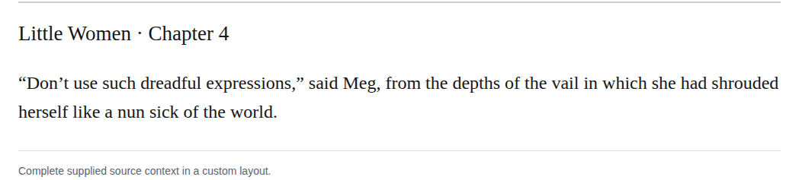

# Spelling veil

In chapter 4, change vail to veil where Meg has shrouded herself in a garment. The garment context supports the same-sound spelling modernization without changing usage or meaning. Recommend it as a discretionary editorial choice with medium confidence; no source error is asserted.

| Location | Current → proposed | Exact patch |
| --- | --- | --- |
| [chapter 4, line 30](https://github.com/standardebooks/louisa-may-alcott_little-women/blob/38695106591f6060142dd1ad4da1d2aeded8ab8f/src/epub/text/chapter-4.xhtml#L30) | <code>vail</code> → <code>veil</code> | [Patch](../changes/chapter4-vail-veil/baseline.patch) |

[Complete changes and proposed messages](../briefs/rule-spelling-veil/appendix.md).

[Standard Ebooks digital text — Ebook context render — chapter 4 — full context render](../assets/image-0057.png).

