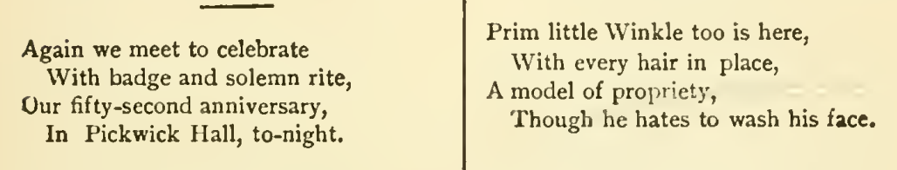
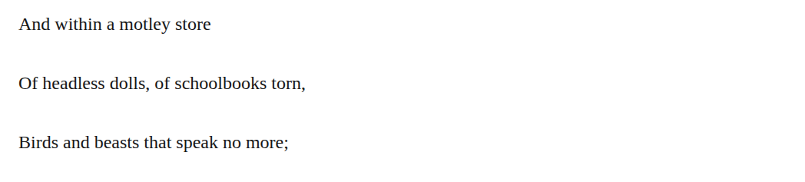

# verse hyphen preservation

In the embedded verse, change tonight to to-night in chapter 10 and schoolbooks to school-books in chapter 46. The retained seven-copy review reports printed to-night at the Ode locus; the school-books proposal instead rests on the supplied preference for retaining poetry hyphens and is a present editorial choice, not a demonstrated restoration. Both recommendations are discretionary with medium confidence. The closed forms remain defensible modernizations; neither edit claims a change in pronunciation, meter or meaning, or proves transmission loss or authorial intention.

| Location | Current → proposed | Exact patch |
| --- | --- | --- |
| [chapter 10, line 35](https://github.com/standardebooks/louisa-may-alcott_little-women/blob/38695106591f6060142dd1ad4da1d2aeded8ab8f/src/epub/text/chapter-10.xhtml#L35) | <code>tonight.&lt;/span&gt;</code> → <code>to-night.&lt;/span&gt;</code> | [Patch](../changes/hyphen-ode-to-night/baseline.patch) |
| [chapter 46, line 182](https://github.com/standardebooks/louisa-may-alcott_little-women/blob/38695106591f6060142dd1ad4da1d2aeded8ab8f/src/epub/text/chapter-46.xhtml#L182) | <code>schoolbooks</code> → <code>school-books</code> | [Patch](../changes/poem-school-books46/baseline.patch) |

[Complete changes and proposed messages](../briefs/rule-verse-hyphen-preservation/appendix.md).

[Standard Ebooks digital text — Ebook context render — chapter 10 — full context render](../assets/image-0209.png).

[Standard Ebooks digital text — Ebook context render — chapter 46 — full context render](../assets/image-0254.png).

