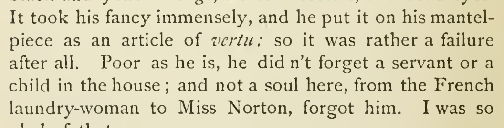

# vertu carrier and language

Use plain roman vertu in “an article of vertu” in chapter 33. The retained basic Merriam-Webster evidence identifies the English art-object noun, and the context describes an ornament. Remove the incorrect Latin language assertion and foreign italics under the dictionary-roman rule, preserving the spelling.

| Location | Current → proposed | Exact patch |
| --- | --- | --- |
| [chapter 33, line 105](https://github.com/standardebooks/louisa-may-alcott_little-women/blob/38695106591f6060142dd1ad4da1d2aeded8ab8f/src/epub/text/chapter-33.xhtml#L105) | <code>&lt;i xml:lang="la"&gt;vertu&lt;/i&gt;; so it was rather a failure after all. Poor as he is, he didn’t forget a servant or a child in the house; and not a soul here, from the French laundrywoman to Miss Norton, forgot him. I was so glad of that.&lt;/p&gt;</code> → <code>vertu; so it was rather a failure after all. Poor as he is, he didn’t forget a servant or a child in the house; and not a soul here, from the French laundrywoman to Miss Norton, forgot him. I was so glad of that.&lt;/p&gt;</code> | [Patch](../changes/vertu/baseline.patch) |

[Complete changes and proposed messages](../briefs/rule-vertu-carrier-and-language/appendix.md).

[1915 Little, Brown (Smith illustrations) — 1915 Little, Brown (Smith illustrations), physical page 454 — full page](../assets/image-0330.png).

