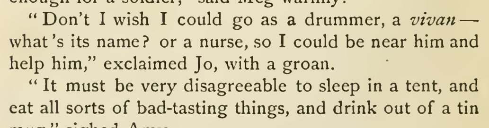

# vivan language removal

Remove xml:lang="es" from the italic vivan fragment in chapter 1. Jo breaks off a military-role list with “what’s its name?”, which does not support a Spanish utterance. Preserve the fragment and italics. This is a supported semantic correction at medium confidence; its exact English/French rendition and mandatory policy force remain undetermined.

| Location | Current → proposed | Exact patch |
| --- | --- | --- |
| [chapter 1, line 85](https://github.com/standardebooks/louisa-may-alcott_little-women/blob/38695106591f6060142dd1ad4da1d2aeded8ab8f/src/epub/text/chapter-1.xhtml#L85) | <code>&lt;i xml:lang="es"&gt;vivan&lt;/i&gt;</code> → <code>&lt;i&gt;vivan&lt;/i&gt;</code> | [Patch](../changes/vivan/baseline.patch) |

[Complete changes and proposed messages](../briefs/rule-vivan-language-removal/appendix.md).

[1915 Little, Brown (Smith illustrations) — 1915 Little, Brown (Smith illustrations), physical page 24 — full page](../assets/image-0332.png).

